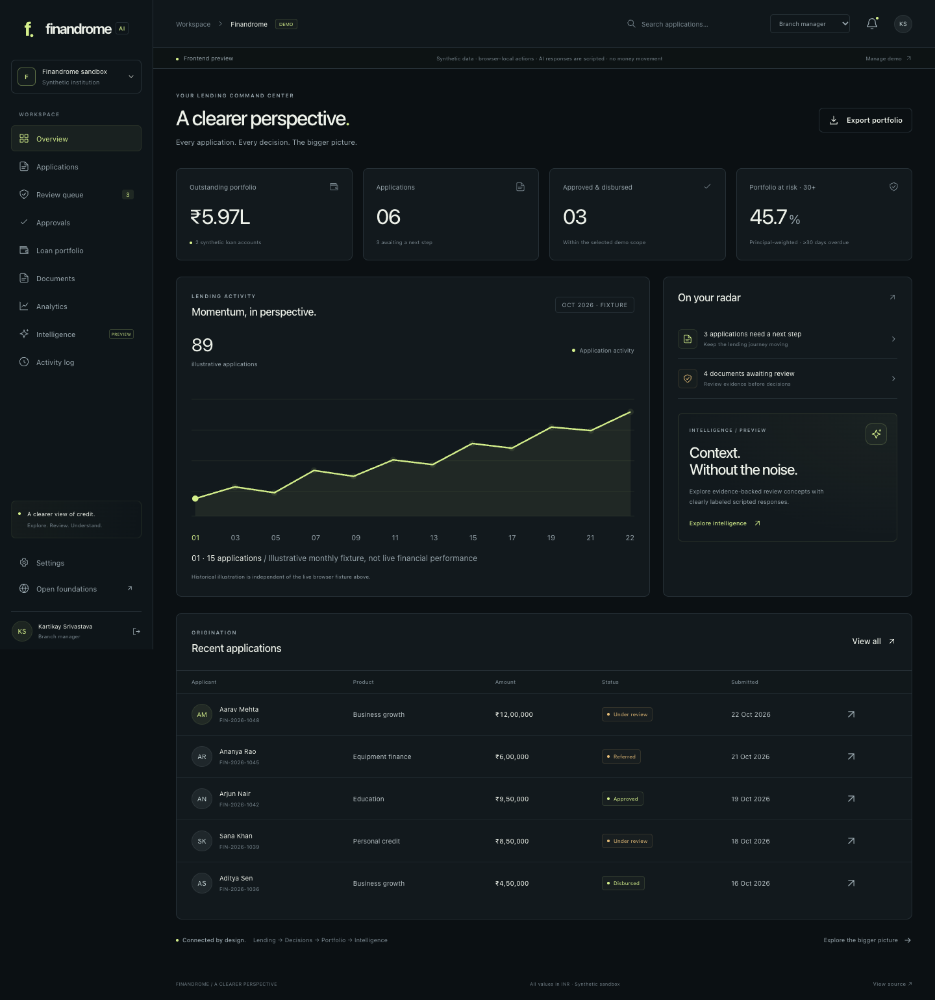
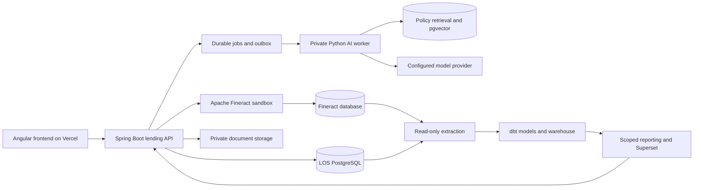

# Finandrome AI

### A clearer perspective on lending.

An AI-assisted lending workspace connecting application intake, human-reviewed decisions and portfolio intelligence. Built by **Kartikay Srivastava**, integrating and extending open-source foundations from the Apache Fineract ecosystem.

[Source](https://github.com/KartikaySr/Finandrome_AI) · [Frontend domain](https://finandrome.kartikaysrivastava.in) · [Architecture & 11-phase blueprint](docs/architecture/BLUEPRINT.md) · [Open-source acknowledgements](OPEN_SOURCE_ACKNOWLEDGEMENTS.md)

> **Current milestone: frontend-first, v0.1.0.** The Finandrome interface runs on synthetic browser-local data. Workflow actions are simulations, AI responses are scripted and document handling records metadata only. The imported Java lending backend and BI stack are not connected to this new frontend yet. The frontend domain above is the intended deployment address; repository presence does not establish that a deployment or DNS configuration is live.

## Interface preview



[Landing page](docs/media/finandrome-landing.png) · [Intelligence preview](docs/media/finandrome-intelligence.png) · [Mobile workspace](docs/media/finandrome-mobile.png)

## Why Finandrome?

Lending is a chain of connected decisions: who applied, what was declared, which evidence is available, who reviewed it, what happened next and how the resulting portfolio behaves. Finandrome brings those perspectives into one product interface.

The frontend is designed to make that chain inspectable. A customer can follow an application. A reviewer can see the context before acting. A manager can distinguish approval from disbursement. An analyst can inspect KPI definitions rather than treating every chart as an answer. The AI experience shows where source evidence belongs in the workflow.

“Web3-inspired” describes the visual direction: a precise dark interface, orbital product illustration, restrained lime accents, thin structural borders and a connected-system motif. This release has **no wallet connection, token, cryptocurrency, smart contract or on-chain transaction**. These are not prerequisites for a lending platform.

## What you can explore now

### Public product experience

- Responsive Finandrome landing page with a CSS-built orbital lending illustration.
- Platform, intelligence and product-principle sections that explain the lending journey.
- A six-persona entry experience, without pretending to create real accounts.
- Open-source acknowledgement page and source-repository links.
- Route-specific browser titles and a useful unknown-route page.

### Lending workspace

- Persistent sidebar navigation, mobile drawer, persona switching and profile/preferences.
- Overview metrics calculated from the current permitted synthetic records.
- Global applicant/reference search, recent activity and scoped navigation.
- Application list with text, product and status filters, amount/date sorting and pagination.
- CSV exports generated from the currently scoped/filtered records.
- Four-step application wizard: applicant, loan details, evidence metadata and final review.
- Client-side field validation, draft creation/editing, demo submission and refresh persistence.
- Application details with financial context, document checklist and decision history.
- Role-aware review, referral, resubmission, approval, rejection and simulated disbursement.
- Required action reasons, native confirmation dialogs and duplicate-demo-loan prevention.
- Loan list, account detail and an explicitly illustrative repayment schedule.

### Documents and evidence

- Searchable document metadata, review-state filters and application links.
- File-picker validation for nonempty PDF/JPEG/PNG files up to 10 MB.
- Local capture of document name, type and size; **file contents are not uploaded or retained**.
- Metadata inspection and simulated human verification/rejection by review personas.
- Clear differentiation between synthetic seed records and locally added metadata.

### Four analytics perspectives

1. **Portfolio health:** outstanding principal, account counts and product composition.
2. **Delinquency & PAR:** PAR30/60/90 and non-overlapping overdue buckets.
3. **Repayment behavior:** illustrative chart history and account context; real collections metrics remain a backend milestone.
4. **Origination:** submitted population, approval share and latest-state distribution.

Portfolio metrics use scoped browser-fixture loan records. The repayment/activity chart series are explicitly separate illustrations. INR is the only currency in this frontend fixture; amounts are never presented as actual assets under management.

### Five AI interaction previews

1. **Application brief:** a scripted summary derived from the selected permitted application.
2. **Document insights:** illustrative mapping of application fields, clearly distinguished from actual OCR.
3. **Policy copilot:** a scripted answer linked to a fictional sample policy section.
4. **Score explanation:** shows the stored illustrative score and refuses to invent unavailable factor contributions.
5. **Portfolio lens:** computes principal and PAR30 from the current permitted synthetic loan scope.

Each scenario has visible source context. Edited free-form questions receive an explicit unsupported response because **no LLM is connected**. The temporary “preparing preview” state is interface simulation, not inference latency. No AI accuracy or performance percentage is claimed for these scripted examples.

### Preferences and traceability

- Browser-local display name and demo email preferences.
- Compact table density and reduced-motion controls.
- Recent-activity notification preference.
- Demo reset with confirmation.
- Read-only local activity exploration and CSV export.
- Administrator view of the six-persona access catalog.

## Demo personas and scope

- **Customer:** own seeded/new applications, related metadata and own synthetic loans; can create, submit and resubmit.
- **Loan officer:** North Branch records; can create an application, start review, refer and simulate document review.
- **Credit reviewer:** North Branch review context; can start review, refer and inspect evidence.
- **Branch manager:** North Branch context; can review, approve/reject and simulate disbursement after approval.
- **Auditor:** read-only global synthetic record inspection, analytics and exports.
- **Administrator:** global synthetic inspection and persona catalog; administration does not itself grant lending approval authority.

These checks model the intended interaction and role behavior. They are **not a security boundary**: browser data and the selected persona can be edited by the user. Server-side identity, session security, object-level authorization and audit durability belong to backend integration.

## Try the frontend locally

### Prerequisites

- Git.
- A compatible Node.js version: supported 22.x starting at 22.22.3, or supported 24.x starting at 24.15.0, for the locked Angular 22 foundation.
- npm and network access to install the committed dependency lock.
- No Java, database, Docker, banking credentials or model API key is needed for the current frontend.

```bash
git clone https://github.com/KartikaySr/Finandrome_AI.git
cd Finandrome_AI/apps/web
npm ci
npm start
```

Open [localhost:4200](http://localhost:4200), select a persona and explore. Everything in the current Finandrome route tree runs without backend HTTP calls.

### Production build and local preview

```bash
cd apps/web
npm run build
node scripts/preview.mjs
```

When starting from the repository root, the production files are in `apps/web/dist/finandrome/browser`. The dependency-free preview server listens on [127.0.0.1:4173](http://127.0.0.1:4173) and supports direct SPA route refresh. It is a local preview utility, not a production backend.

### A useful demo journey

1. Enter as **Customer** and create a fictional application through all four wizard steps.
2. Copy its detail URL; switch to **Loan officer** and open that application again.
3. Start review and record a reason. Optionally refer it and return as Customer to resubmit.
4. Switch to **Branch manager**, open the application and approve it with a reason.
5. Simulate disbursement with an explicit confirmation; inspect the new demo loan account.
6. Inspect analytics and the activity log; export the scoped records.
7. Open Intelligence and explore a source-linked scripted preview for that application.
8. Use Settings to reset the browser fixture when finished.

Simulated disbursement creates a local demo loan record. It does not call Fineract or transfer funds. The sample schedule uses a flat 12% illustration and is not an actual loan offer, interest engine or Fineract-generated schedule.

## Frontend architecture

```text
Browser
  └── Angular standalone application
      ├── Public landing, persona entry, acknowledgements
      ├── Route session/persona guards (demo UX only)
      ├── Workspace shell and lazy-loaded feature views
      ├── DemoStore: signals, computed selectors and workflow checks
      ├── Synthetic fixture: applications, loans, metadata and events
      └── localStorage state + sessionStorage demo persona
```

New Finandrome code lives in `apps/web/src/app/product/`. Feature pages consume one typed demo store rather than maintaining unrelated fake totals. Computed selectors apply the selected persona's scope before lists, exports and derived metrics are presented. The store owns simulated transition rules and records their activity.

Routes lazy-load feature components. Shared icon and chart components are code-native SVG; there is no external icon CDN or hero image dependency. Layouts adapt to mobile, tablet and desktop, while native dialogs provide modal focus behavior. Reduced motion honors both the browser preference and the saved workspace option.

Inherited frontend modules remain under the existing `core`, `features`, `layout` and `shared` directories for provenance and staged integration. They are **not the active Finandrome route tree**. Their presence does not mean the new frontend is connected to the inherited backend.

### Where to work

```text
apps/web/src/app/product/
  data/
    models.ts                  Typed demo contracts and formatting
    seed.ts                    Deterministic fictional fixture
    demo-store.ts              Scope, mutations, persistence and exports
    demo-store.spec.ts         Workflow, isolation and recovery tests
  layout/
    shell.ts / shell.html      Navigation, search and session UX
  pages/
    landing.*                  Public product experience
    login.ts                   Six-persona entry
    overview.*                 Lending overview
    applications.*             Scoped list, filters and pagination
    application-new.*          Four-step intake
    application-detail.*       Evidence, history and decisions
    loans.*                    Accounts and illustrative schedules
    analytics.*                Four dashboard perspectives
    documents.*                Local metadata and review states
    intelligence.*             Five scripted assistance experiences
    administration.*           Preferences, activity and persona catalog
    open-source.ts             Attribution and product boundaries
    not-found.ts               Unknown-route state
  ui/
    icon.ts                    Shared SVG icon paths
    chart.ts                   Accessible labeled chart interaction
  product.scss                 Tokens, layout and responsive design
```

## Complete system architecture — next integration milestones



This diagram is the intended integrated system. Today only the Angular/demo-store path is implemented as the new Finandrome frontend; the imported services and analytics source are staged for subsequent work.

### Backend responsibilities

- Identity/session, tenant/office authorization and server-owned customer linkage.
- Application versions, document security and immutable review context.
- Versioned deterministic scoring and staged approval rules.
- Idempotent Fineract integration with reconciliation after ambiguous external outcomes.
- Real loan/schedule/repayment visibility from Fineract.
- Durable audit/outbox/jobs, notifications and operator recovery.
- Authorized AI task gateway, evidence schemas and usage budgets.
- Scoped reporting APIs backed by reconciled warehouse models.

### AI responsibilities

The planned AI worker adds actual document extraction, application summarization, policy retrieval, score explanation and bounded aggregate questions. Generation must be evidence-linked, role-scoped and schema-validated. Lending decisions remain deterministic and human-authorized; model tools must not approve/disburse loans or change access controls.

Evaluation targets include extraction accuracy, factual grounding, task correctness, abstention, isolation, latency and spend visibility. See the blueprint for exact datasets and denominators. The proposed **95% targets are not measured achievements**.

## Repository layout

```text
Finandrome_AI/
  apps/web/                    Active Finandrome Angular frontend
  services/lending-api/        Imported Java LOS foundation; not integrated yet
  analytics/                   Imported Python/dbt/Superset BI foundation
  docs/architecture/           Detailed blueprint and 11 rollout phases
  docs/evidence/               Verification notes and measured results
  .github/workflows/           Frontend checks and browser tests
  LICENSE                      Apache License 2.0
  OPEN_SOURCE_ACKNOWLEDGEMENTS.md
  UPSTREAM.md                  Exact archive snapshots and import boundaries
  README.md
```

## Technology stack

**Active frontend:** Angular 22, TypeScript 6, RxJS, Angular signals/reactive forms, SCSS, code-native SVG charts/icons, Vitest, Playwright and npm lockfiles.

**Imported backend foundation:** Java 21 target, Spring Boot 4.1.1 source baseline, Maven Wrapper, Spring Security, Spring Data JPA, Flyway, PostgreSQL and REST Fineract adapters.

**Imported analytics foundation:** Python, pg8000, PostgreSQL, dbt-postgres and Apache Superset.

**Planned AI implementation:** Python/FastAPI/Pydantic, durable jobs, document parsing/OCR, provider adapters, pgvector and a versioned evaluation suite. Exact provider/model selection is intentionally deferred until benchmarking.

**Deployment boundary:** Vercel serves the static Angular frontend. Stateful Java/Python services, Fineract, databases and workers require separate persistent hosting.

## Verification

Run from `apps/web`:

```bash
npm run typecheck
npm run lint
npm run format:check
npm test -- --watch=false
npm run build
npx playwright install chromium
npm run test:e2e
```

Browser tests use the production build and the local preview server. Build before running them. They exercise persona scope, the application-to-simulated-loan journey, refresh persistence, filtering, all analytics perspectives, all five AI scenarios, document metadata validation, preferences, exports, mobile navigation and runtime page errors.

The original frontend tests are retained, and new tests verify Finandrome workflow behavior. These tests do not validate real bank integrations, real authentication, OCR, LLM accuracy, financial calculations or server-side security. Consult [the frontend verification record](docs/evidence/FRONTEND-VERIFICATION.md) for actual results and known limits.

Angular's persistent cache is disabled in this workspace to avoid a native LMDB crash observed on the local macOS toolchain. This does not disable compilation or type checking. Production builds remain optimized and are split into lazy feature chunks.

## Deploy the frontend on Vercel

1. Import [KartikaySr/Finandrome_AI](https://github.com/KartikaySr/Finandrome_AI) into Vercel.
2. Set **Root Directory** to `apps/web`.
3. Select the Angular preset and a Node version compatible with the locked dependency set.
4. Use `npm ci` for installation and `npm run build` for the build.
5. Use output directory `dist/finandrome/browser`.
6. Keep the included `apps/web/vercel.json` SPA fallback and security headers.
7. Add `finandrome.kartikaysrivastava.in` in the project's Domains settings and configure the exact DNS records Vercel supplies.
8. Verify HTTPS, public landing, persona entry, direct detail-route refresh and static asset delivery.

The current frontend needs **no API key or backend URL**. Do not add model secrets, database credentials or financial data to a Vercel frontend bundle. Backend environment configuration will be added when real integration replaces the demo adapter.

Official references: [Angular deployment](https://angular.dev/tools/cli/deployment), [Angular version compatibility](https://angular.dev/reference/versions), [Vercel domain configuration](https://vercel.com/docs/domains/working-with-domains/add-a-domain).

## Rollout plan

The detailed blueprint contains exactly 11 dependency-ordered phases. The owner has chosen to implement the frontend first, so UI work is intentionally being pulled forward across those phases. This does not mark backend phases complete.

1. Product definition, provenance and measurable requirements.
2. Reproducible baseline and source remediation.
3. Finandrome shell, identity and permission foundation.
4. Customer intake, application versions and document handling.
5. Staff review, scoring and controlled approvals.
6. Real Fineract sandbox lifecycle and recovery.
7. Warehouse, four dashboards and KPI reconciliation.
8. AI foundation, evidence store and evaluation harness.
9. Five AI features and reviewer feedback.
10. Integrated validation, scale, accessibility and recovery.
11. Vercel rollout, portfolio release and resume evidence.

### Next implementation priorities

- Finish frontend UX/accessibility review and browser regression coverage.
- Resolve inherited backend migration/dependency/container issues before connecting it.
- Add a typed API adapter behind the frontend's feature contracts, replacing browser mutations incrementally.
- Implement authenticated session handling and server-side authorization before accepting private data.
- Demonstrate one real sandbox Fineract journey before expanding integration breadth.
- Add durable document processing and evidence-backed live AI after the evaluation suite exists.
- Reconcile warehouse KPIs and record real benchmark results before publishing performance claims.

## Known boundaries and source issues

- The imported LOS includes two version-8 Flyway migrations; migration strategy must be resolved before backend startup on a fresh database.
- Its Compose definition references a missing Dockerfile and ports inconsistent with the backend's configured listener.
- Some inherited dependency/documentation/configuration details require alignment.
- Inherited auth/storage code is retained for future review; it is not the active Finandrome demo session mechanism.
- Browser localStorage is editable and does not provide secure authorization or audit guarantees.
- Uploaded document contents are not stored, parsed, scanned or sent anywhere by the demo.
- Charts labeled illustrative are not reconstructed historical banking records.
- The product is a portfolio/sandbox implementation, not a production-regulated lending service.

The complete source assessment, remediation queue, API proposal, data model and rollout gates are in [BLUEPRINT.md](docs/architecture/BLUEPRINT.md).

## Contributions, provenance and licensing

New Finandrome product code is by Kartikay Srivastava. The lending backend, inherited frontend modules and BI pipeline include substantial code from the Apache Fineract ecosystem. See [UPSTREAM.md](UPSTREAM.md) for source snapshots and [OPEN_SOURCE_ACKNOWLEDGEMENTS.md](OPEN_SOURCE_ACKNOWLEDGEMENTS.md) for credits.

Distributed under the [Apache License, Version 2.0](LICENSE), subject to applicable third-party notices and dependency licenses. Original copyright/license headers remain in inherited source. Finandrome does not claim Apache endorsement or exclusive authorship of those foundations.
