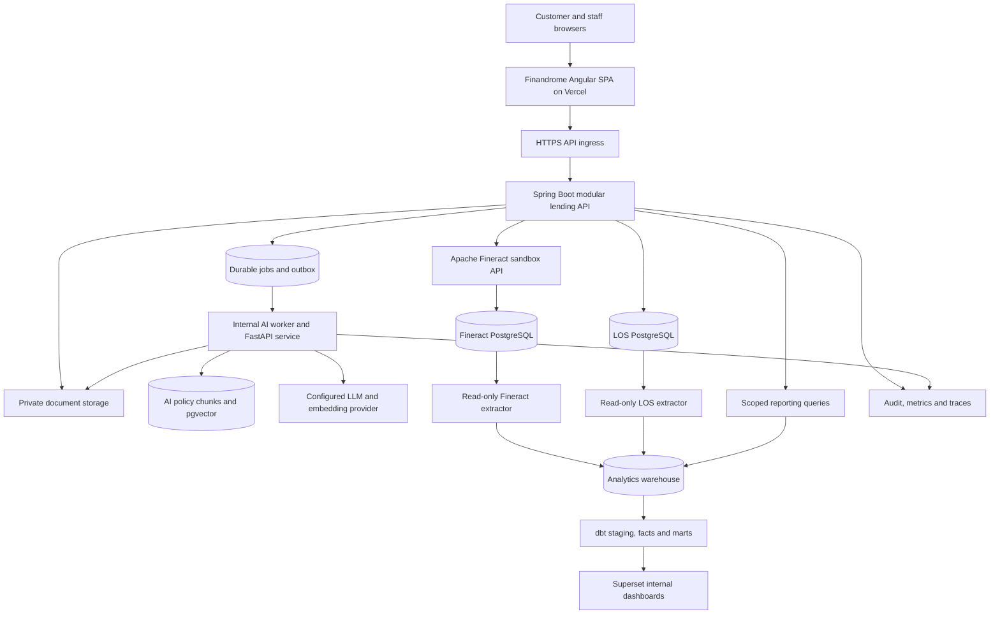
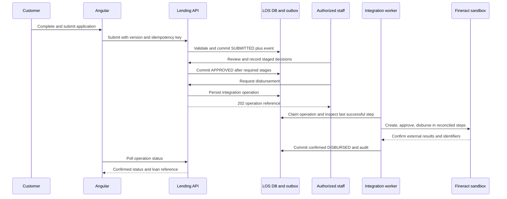

# Finandrome AI

## Architecture, modules, feature specification, success metrics and 11-phase rollout

**Owner:** Kartikay Srivastava  
**Document date:** 22 October 2026  
**Implementation note:** The owner selected a frontend-first rollout. The new Finandrome UI now has browser-local workflow simulations, analytics and scripted AI interaction previews; the backend, warehouse and live AI integration gates below remain future work. See the root README and verification record for the current tested scope.

**Status:** Proposed integrated-system blueprint; no completed implementation, benchmark or deployment is asserted by this document.  
**Repository:** [KartikaySr/Finandrome_AI](https://github.com/KartikaySr/Finandrome_AI) — supplied by the owner; repository contents and accessibility were not verified.  
**Frontend deployment target:** [finandrome.kartikaysrivastava.in](https://finandrome.kartikaysrivastava.in) — intended Vercel custom domain; live deployment and DNS have not been verified.  
**Product description:** An AI-assisted lending workflow and analytics platform integrating customer applications, staff approvals, Apache Fineract loan servicing, evidence-backed AI assistance and portfolio intelligence.

> This is the specification to build against, not a claim that all features already exist. Every numerical result below is a target unless explicitly identified as an observed source fact. Resume claims must be updated from recorded test results after implementation.

## Contents

1. [Upfront success metrics and resume evidence](#1-upfront-success-metrics-and-resume-evidence)
2. [Product definition and scope](#2-product-definition-and-scope)
3. [Source assessment and first fixes](#3-source-assessment-and-first-fixes)
4. [Technology stack](#4-technology-stack)
5. [System architecture](#5-system-architecture)
6. [Frontend architecture and modules](#6-frontend-architecture-and-modules)
7. [Backend architecture and modules](#7-backend-architecture-and-modules)
8. [AI architecture and feature details](#8-ai-architecture-and-feature-details)
9. [Data architecture and metric definitions](#9-data-architecture-and-metric-definitions)
10. [API contracts and integration flows](#10-api-contracts-and-integration-flows)
11. [Security, reliability and observability](#11-security-reliability-and-observability)
12. [Repository and deployment architecture](#12-repository-and-deployment-architecture)
13. [Exactly 11 rollout phases](#13-exactly-11-rollout-phases)
14. [Verification and release checklist](#14-verification-and-release-checklist)
15. [Resume and portfolio presentation](#15-resume-and-portfolio-presentation)
16. [Dependencies, decisions and references](#16-dependencies-decisions-and-references)

## 1. Upfront success metrics and resume evidence

### 1.1 What the finished project should demonstrate

The primary achievement is a reproducible lending journey: a synthetic customer submits an application, staff assess it, an authorized manager approves it, a real sandbox Fineract instance creates and disburses the loan, a repayment is recorded, analytics refresh, and AI helps explain the application and portfolio with traceable evidence.

Six proposed personas are customer, loan officer, credit reviewer, branch manager, administrator and auditor. A persona is a product role with explicit permissions, not necessarily a new authentication system. The initial approval chain remains loan officer then branch manager; credit review is a configurable additional stage.

Five AI capabilities are planned: document extraction and consistency checks; application review summaries; policy search with citations; explanations of deterministic credit scores; and bounded portfolio questions. These are assistance features, not autonomous lending decisions.

### 1.2 Target scorecard

**M01 — Functional completeness.** Target: 12 acceptance journeys pass in an integrated sandbox, covering successful origination, referral/resubmission, rejection, unauthorized approval, upstream timeout recovery, repeat disbursement requests, repayment display, analytics reconciliation, document review, policy Q&A, application summary and AI outage fallback. Evidence: versioned end-to-end report, screenshots and a recorded demonstration. Denominator: the 12 named journeys; subcases do not inflate the count.

**M02 — Persona and data isolation.** Target: implement all six personas and pass all cases in a minimum 60-case permission suite, including at least 20 object-level, tenant, office or AI-retrieval isolation denials. Evidence: permission matrix plus executable integration reports. A passing suite is bounded evidence, not a claim of universal security.

**M03 — API performance.** Target under the benchmark in section 1.3: p95 latency at or below 500 ms for ordinary reads and 800 ms for ordinary writes; unexpected failure rate below 1%; sustain 20 scheduled requests/second with up to 50 virtual users for 15 measured minutes. Exclude AI/OCR, report exports and Fineract-dependent calls from these latency buckets; measure those separately. Report all three runs, including the worst result and dropped load-generator iterations.

**M04 — Dataset scale.** Target: reproducibly seed 10,000 synthetic customers, 20,000 LOS applications, 10,000 Fineract loans, 120,000 repayment schedule rows and 50,000 loan transactions across three offices and four loan products, initially in INR. The loan rows must be tied to supported API-created fixtures or a tested sandbox fixture loader, not merely hand-written lookalike tables. Scale is a test dataset, not a count of real users or serviced loans.

**M05 — Analytics correctness.** Target: four dashboards, at least 12 documented business KPIs and zero unexplained reconciliation differences on the seeded fixture. Monetary comparisons use minor currency units; displayed rounding is handled separately. PAR hierarchy and denominator tests must pass. Evidence: dbt results, SQL checks and reconciliation report.

**M06 — Analytics freshness.** Target: 95% of successful end-to-end pipeline refreshes make committed source changes queryable within 20 minutes during a 24-hour controlled test, using a proposed 15-minute extraction cadence. Measure commit-to-queryable latency, not just job duration. Record source business date, warehouse watermark, failures and close-of-business gating. This changes the supplied hourly default and must be tested.

**M07 — AI extraction quality.** Target: at least 95% exact-match accuracy on eligible fields from 60 labeled synthetic documents: 20 income documents, 20 bank-statement samples and 20 application/identity-form samples. Fix the field schema before evaluation; report accuracy by document type and field as well as overall. Normalization rules are predefined. Abstentions count as missed expected fields; extra invented fields are reported as false extractions. This does not certify identity, KYC or fraud detection.

**M08 — AI grounding.** Target: at least 95% of factual statements supported by the cited authorized evidence across 60 labeled questions/tasks, with at least 90% end-to-end task correctness. A statement counts as grounded only if its citation exists, is accessible to that user and supports the statement. Include application summaries, policy answers, credit explanations and portfolio answers. Also test 10 unanswerable prompts separately; target at least 9 correct abstentions. Report human review rubrics and feature-specific results; citations alone do not establish correctness.

**M09 — AI isolation and failure behavior.** Target: all 40 specified adversarial cases pass: 10 cross-tenant/office requests, 10 malicious-document prompts, 10 unauthorized tool/data requests and 10 provider failure/schema/cost-limit cases. Zero write-capable LLM tools; every lending state change requires a deterministic authorized API action. Evidence: redacted test traces and decision audit records.

**M10 — AI response time and spend visibility.** Target: p95 below 15 seconds for summary/policy/explanation jobs on the fixed evaluation inputs, excluding queue wait, reported alongside end-to-end queue-inclusive latency. Document processing target: p95 below 60 seconds for clean documents of at most five pages. Record model/provider, input size, concurrency, token usage, retries and cost for every evaluated call. Enforce configured per-job and daily spend ceilings; no dollar estimate is an achieved result before selecting a provider and measuring usage.

**M11 — User experience.** Target: Lighthouse mobile performance and accessibility scores of at least 90 on the public landing page and two reproducible authenticated fixture pages; median of three runs per page under one recorded configuration. Verify keyboard completion of application and staff review journeys, field-level errors and responsive layouts at 360, 768 and 1440 px. Automated scores do not replace manual accessibility checks.

**M12 — Business-analysis evidence.** Target: one FRD, one role/permission matrix, at least eight process/sequence diagrams, at least 25 user stories and at least 40 UAT scenarios, all linked through requirement IDs to features, tests and rollout phases. Counts are delivery scope; quality is established by review and traceability. Stakeholders are simulated unless actual interviews occur.

**M13 — Recovery and integration safety.** Target: no duplicate external loan creation or disbursement in 20 controlled duplicate/timeout/crash recovery scenarios; tested backup restore with recovery time at or below 60 minutes and recovery point at or below 24 hours for the demo environment. Record recovery duration and data timestamps. Do not advertise exactly-once delivery across network boundaries.

**M14 — Release evidence.** Target: CI build/test reports for frontend, backend, AI worker and BI; a tagged integrated release; a verified GitHub source link; and a reachable HTTPS frontend on the requested custom domain with deep-link refresh working. Target zero unresolved critical/high findings applicable to reachable release paths; record accepted exceptions and affected features rather than hiding findings. No uptime percentage is promised without an observed monitoring window.

### 1.3 Benchmark protocol and starting baseline

Starting baseline: source files were inspected, but no application build, CI run, load test, AI evaluation, live domain verification or end-to-end integration was performed for this specification. The upstream code provides implementation candidates; inherited tests are not automatically passing tests.

Performance profile: application container limited to two vCPU and 4 GiB RAM; LOS PostgreSQL allocated two vCPU and 4 GiB; a separate sandbox Fineract instance with its own database; all benchmark services in one region. Record actual host type, total resources, storage, software versions and network placement. Background BI/AI load must either be disabled and disclosed or measured in a separately labeled mixed-workload run. If shared-host contention prevents these allocations, record the actual environment and revise targets explicitly.

Use a fixed synthetic seed and 80% reads / 20% ordinary application writes. Reads include paginated lists, own application detail and staff queue detail. Writes include draft save, profile update and draft creation. Exclude invalid auth requests from ordinary performance traffic. Run three minutes of warm-up followed by 15 measured minutes, three times. At 20 requests/second this schedules 18,000 measured requests per run. Track delivered requests and dropped iterations; do not silently report a lower achieved rate as 20 requests/second. External-call and AI scenarios receive separate timeout and latency reports.

Set a maximum page size of 100. Persist raw k6 outputs, commit SHA, seed manifest, environment manifest and a concise interpretation in `docs/evidence/performance/`. Measure Phase 2 baseline and Phase 10 final results with the same protocol before making comparative claims.

### 1.4 Evidence and measurement rules

- Every metric has an owner, definition, target, actual result, timestamp, source command and linked artifact.
- Leave unmeasured actual results as `Not measured`, never zero or an invented success percentage.
- Report synthetic scale as synthetic. Distinguish design capacity, tested capacity and real usage.
- Report improvements only against a measured baseline using the same workload and hardware.
- Do not claim reduced loan defaults, real customer adoption, fraud prevention or staff productivity gains from a demo alone.
- For an optional staff-review time study, compare the same tasks with and without AI using at least 20 randomized paired tasks. Report median time, review accuracy, participants and limitations. No productivity percentage is promised in advance.

## 2. Product definition and scope

### 2.1 Problem and intended users

A loan application contains customer data, financial details, documents, policy checks and a sequence of staff decisions. Origination and subsequent loan performance often appear in different systems. Finandrome should connect those stages and make the evidence behind each decision easy to inspect.

The customer needs a clear application form, progress tracking and understandable document requests. The loan officer needs an actionable queue and a complete review workspace. The branch manager needs controlled approvals and portfolio visibility. The credit reviewer needs documented scoring factors and policy references. The administrator needs configuration and access management. The auditor needs authorized, read-only decision history.

### 2.2 Release scope

Include customer application intake, profile management, synthetic document upload/review, transparent rule-based scoring, referral handling, configurable staged approval, real sandbox Fineract integration, repayment visibility, audit history, analytics and the five AI assistants.

The release is a portfolio/sandbox product. Exclude real payment settlement, production credit bureau connections, regulatory KYC certification, autonomous loan decisions, training a proprietary underwriting model, universal banking functionality and claims of production regulatory readiness. A Fineract disbursement record demonstrates a banking-system action; it does not prove money moved through a payment network.

### 2.3 Brand and contribution boundaries

Use Finandrome for product navigation, visual identity, deployment configuration and new documentation. Credit Apache Fineract, the loan-origination source project and the BI source project in an open-source acknowledgements document. Preserve existing license/copyright notices and applicable notice files when copying source. Record upstream snapshot hashes and modifications in `UPSTREAM.md`.

Describe the work as integrating and extending open-source foundations. Distinguish inherited features from new Finandrome work: unified UX, integration fixes, enhanced access controls, reliable orchestration, AI assistance, additional analytics, deployment and evidence are proposed contribution areas. Merely changing branding does not establish authorship of inherited code.

## 3. Source assessment and first fixes

### 3.1 Observed source foundations

Loan-origination archive: `fineract-loan-origination-main.zip`, archive comment commit `8b45445d729087ac4c7202653eefddadd957f600`. Inspected README, Maven definition, Angular dependencies/routes, application configuration, integration documentation, loan state enum, API-client interface and disbursement service.

Observed frontend foundations include customer and staff layouts; login, application creation/list/detail, dashboard, profile and additional route components. Route existence is not evidence that every screen is connected to a working backend.

Observed backend foundations include Spring Boot REST APIs, JPA entities, approval workflow, credit scoring, customer/staff authentication and a Fineract adapter boundary. The state enum contains seven states: `DRAFT`, `SUBMITTED`, `UNDER_REVIEW`, `APPROVED`, `REJECTED`, `REFERRED`, `DISBURSED`. Some source documentation calls this six states; Finandrome must use the actual seven-state contract consistently.

BI archive: `fineract-business-intelligence-main.zip`, archive comment commit `765aacc14ebfd566e361ec764c542f4207c412df`. Inspected README, architecture headings, extractor, portfolio SQL, dependency files and deployment components. Foundations include PostgreSQL extraction, dbt stages/facts/marts, office-aware datasets and three dashboard specifications: Portfolio Health, Delinquency & PAR, and Repayment Behavior.

All AI features in this specification are proposed new work. A validated AI application, a verified full-stack deployment and the expanded origination funnel dashboard were not established by the supplied source review.

### 3.2 Concrete remediation queue

1. **Duplicate migration versions:** LOS has `V8__add_fineract_client_id.sql` and `V8__create_staff_credentials.sql`. Resolve uniquely for fresh databases. If any database has already applied either migration, inspect history and use a forward-compatible repair strategy; do not casually rewrite applied migration history.
2. **Missing container build file:** LOS Compose references a root `Dockerfile`; the archive inventory has no file with that name. Add and validate a multi-stage Java container build.
3. **Port mismatch:** Compose publishes `8080:8080`, while application configuration sets port `8082`. Standardize the container listener and health checks on 8082, and route the edge proxy accordingly.
4. **Dependency alignment:** source Java dependencies mix JJWT API/runtime versions and Cucumber versions. Resolve compatible versions, dependency convergence and supported compiler/runtime combinations before feature work.
5. **Mock defaults:** the LOS defaults to mock Fineract. Maintain explicit `demo-mock` and `sandbox-integrated` profiles with visible UI mode and release evidence for the integrated profile.
6. **Integration reliability:** the disbursement service's comments describe isolated transactions, but the inspected public orchestration method is `@Transactional` and calls external APIs. Implement a persisted step/reconciliation design and test failures rather than relying on comments or simplistic retries.
7. **Schema management:** move deployed environments away from Hibernate `ddl-auto: update` to migration-owned schemas and validation after the migration baseline is proven.
8. **Configuration hygiene:** replace source development credentials with environment-provided values, disallow insecure demo defaults in deployed integrated profiles, and align actual datasource ports with Compose.
9. **Documentation drift:** integration docs describe fewer integration actions than the inspected create/approve/disburse client. Regenerate behavior diagrams from the tested implementation.
10. **BI deployment coupling:** remove the assumption that an externally named Docker network already exists; provide a tested integrated network configuration and source compatibility views.
11. **Analytics scope:** the supplied BI warehouse reads Fineract, not the LOS application lifecycle. Add a separate read-only LOS feed for origination conversion and turnaround metrics.

## 4. Technology stack

### 4.1 Frontend

- **Angular 22.x and TypeScript 6.0.x:** retain the existing Angular foundation; align all Angular packages to a tested compatible release rather than rewriting the client in another framework.
- **Node.js 24.x:** proposed build runtime, with exact patch selected from the Angular compatibility matrix and verified in CI/Vercel. The inspected compatibility reference lists Node 24.15.0 or newer within its supported 24.x range for Angular 22.0.x; verify the selected 22.x release explicitly.
- **RxJS, reactive forms and signals:** HTTP/event composition, typed form validation and local view state. Add a global store only if cross-feature state complexity justifies it.
- **SCSS and design tokens:** one branded component system with accessible controls, responsive layouts, status badges and empty/error/loading states.
- **Apache ECharts:** proposed rendering library for custom first-party analytics views; confirm package compatibility and license in Phase 2. Superset remains the analyst dashboard tool.
- **Vitest, Playwright, axe-core and Lighthouse CI:** unit, browser, accessibility and performance evidence.
- **Vercel:** static SPA deployment and Git-linked preview builds. Spring Boot, PostgreSQL, Fineract, Superset and persistent workers run elsewhere.

### 4.2 Lending backend and data

- **Java 21 and Spring Boot:** source POM requests Spring Boot 4.1.1. Java 21 is retained; resolve and lock a fully tested dependency set in Phase 2. This is a proposed source-compatible baseline, not evidence that the supplied POM already builds.
- **Spring Web, Security, Validation, Data JPA and Actuator:** API, authorization, typed request validation, persistence and health/metrics.
- **Maven Wrapper, Flyway, PostgreSQL 16:** reproducible build and migration-owned relational storage. Use separate LOS, Fineract and analytics databases with distinct credentials; validate the chosen Fineract release against its own database requirements.
- **Apache Fineract:** separately deployed sandbox loan-account and repayment system of record, pinned to a tested image digest.
- **S3-compatible object storage:** document bytes and exports in a private bucket. Local development may use a compatible local service; confirm the service's license before redistribution.
- **PostgreSQL-backed jobs and transactional outbox:** initial reliable work queue without introducing Kafka/Redis solely for appearance. Leases, attempts, scheduled retries and dead-letter status are explicit.

### 4.3 AI and analytics

- **Python 3.12, FastAPI and Pydantic:** separate internal AI service plus a durable background worker. The HTTP service validates/enqueues work; OCR/LLM execution happens in the worker, not an untracked process-local background task.
- **Hosted LLM and embedding provider through an adapter:** choose exact provider, models and SDK/API version after the evaluation harness exists. Pin model identifiers and embedding dimensions. Do not assume provider features, pricing or data retention without verification.
- **PostgreSQL + pgvector:** policy-document vectors and metadata in a dedicated AI database/schema with server-enforced scope and version filters. Small-corpus exact search first; benchmark any approximate index before adoption.
- **PDF text extraction and optional Tesseract OCR:** extract selectable text first; OCR only image/scanned pages. Treat extracted text as untrusted input. Scan or reject oversized, encrypted or unsupported documents.
- **Python pg8000, dbt-postgres and PostgreSQL warehouse:** retain the BI extraction/modeling approach. Source specifies pg8000 1.31.5 and dbt-postgres >=1.11,<2; create a reproducible tested lock rather than keeping an open range in release builds.
- **Apache Superset:** source container uses 4.1.1. That is an observed upstream pin, not an assertion that it is a suitable current release; select and test a maintained version after security review.

### 4.4 Delivery and monitoring

Docker Compose for the integrated sandbox; GitHub Actions for CI; versioned container images; Caddy or Nginx for backend HTTPS ingress; OpenTelemetry-compatible traces, structured logs and Prometheus-style metrics. Add a Grafana view if it improves the demonstration; core health and evidence must not depend on a large monitoring installation.

Use k6 for API load, JUnit/Spring Security/Testcontainers for backend verification, pytest for AI tests, and dbt tests for data invariants. Avoid Kubernetes, distributed service meshes and custom model training in the initial release.

## 5. System architecture

### 5.1 Topology



### 5.2 Ownership and deployment boundaries

The lending API is a modular monolith: one Java deployment with clear domain modules and controlled dependencies. The AI service is separate because parsing/OCR, provider failures and variable execution time should not block lending transactions. BI is an asynchronous read-only subsystem. Fineract is an external core service, never an implementation detail silently replaced by LOS tables.

The LOS database owns applications and approvals; Fineract owns loan accounts and repayments; the warehouse owns derived analytical snapshots; object storage owns document bytes; the AI store owns chunk/index metadata and task outputs. No component writes another component's business tables directly. Extractors use explicit read-only grants.

The public Vercel origin only receives the Angular bundle and public configuration. The API is the browser's sole business-data entry point. AI providers, model secrets, database ports and Superset administrative access remain off the public frontend.

### 5.3 Architectural decisions

- Retain Angular and Spring Boot to build on the supplied system and focus effort on integration and measurable improvements.
- Keep authoritative lending calculations deterministic; use AI for extraction, summarization and explanation.
- Use a PostgreSQL job/outbox mechanism first; add a dedicated broker only if measured throughput or independent scaling requires it.
- Serve customer/staff analytics through scoped backend report endpoints. Keep direct Superset access restricted to authorized analyst roles.
- Design for one synthetic institution first, while enforcing tenant and office scope in tests. Multi-tenant production isolation is a separate maturity step.
- Use synthetic data in the public demo. Public visitors may explore a resettable read-only scenario; write-capable test personas remain controlled.

## 6. Frontend architecture and modules

### 6.1 Application structure

```text
apps/web/src/app/
  core/
    auth/                    Session state and authentication adapters
    api/                     Typed clients, pagination and error handling
    guards/                  Navigation permission checks
    interceptors/            Correlation IDs and session handling
    config/                  Public environment configuration
  shared/
    ui/                      Buttons, dialogs, forms, tables, skeletons
    forms/                   Money, dates and document inputs
    evidence/                AI source citations and evidence drawers
    status/                  Business states and async job presentation
  layouts/
    public/ customer/ staff/ administration/
  features/
    landing/ auth/ profile/ applications/ documents/
    review/ approvals/ loans/ analytics/ ai-assistant/
    administration/ audit/ acknowledgements/
```

Lazy-load feature areas. Keep session and role state centralized; keep form drafts and list filters local unless cross-route persistence is needed. Generate or validate API types from the published OpenAPI contract. Do not render backend error strings directly as HTML.

Every data screen includes loading, empty, denied, failure, retry and stale-data states. Money uses decimal-safe formatting with a currency code; timestamps show explicit timezone context. Display current environment and whether Fineract/AI is mocked.

### 6.2 F01 — Public product and authentication

**Routes:** `/`, `/login`, `/staff/login`, `/about/open-source`.

Provide the Finandrome landing page, capability overview, safe demo instructions and open-source acknowledgements. Separate customer and staff login experiences. Use accessible forms with generic authentication failure messages, rate-limit feedback and session-expired handling. Logout revokes/invalidates the refresh session and clears client state.

Acceptance: public pages have no private-data requests; protected route reloads restore a valid session; expired sessions return to login without leaving application data on screen. A route guard improves UX but never replaces backend authorization.

### 6.3 F02 — Customer profile and eligibility inputs

**Routes:** `/app/profile`, `/app/settings`.

Capture contact details, employment category, declared income, existing obligations and document references needed for the synthetic loan scenario. Validate money, date ranges and required fields. Show which fields are customer-entered, extracted from a document or confirmed by staff. Submitted application versions retain their own historical snapshot even when the profile changes.

Acceptance: customers can view/edit only their own allowed fields; incomplete information produces actionable errors; profile changes cannot silently alter an already reviewed application.

### 6.4 F03 — Application wizard and tracking

**Routes:** `/app/applications`, `/app/applications/new`, `/app/applications/:reference`.

Use steps for product selection, amount/term, financial inputs, documents, declarations and confirmation. Save drafts explicitly and show last-save status. Before submission show a complete review screen. After submission display a read-only snapshot, status history and outstanding staff requests.

Referral/resubmission needs its own limited correction form and a new application version; it must not reopen all locked decision fields. Prevent duplicate clicks with an idempotency key, while still enforcing deduplication server-side. Persist sensitive drafts on the server rather than in persistent browser storage.

Acceptance: refreshing a saved draft preserves its state; two submit clicks create one submission; prohibited transitions render a helpful conflict message; customers cannot choose an approval status in request payloads.

### 6.5 F04 — Documents and AI extraction review

**Routes:** document area inside application detail.

Show required document checklist, upload progress, validation outcome, extraction job state and staff verification state. Document states include uploaded, quarantined, processing, needs review, verified and rejected. AI field suggestions appear alongside source page/snippet and must be accepted or corrected individually; they do not silently overwrite verified inputs.

Acceptance: unsupported files are rejected, signed download links expire, extracting one application's document never exposes another's contents, and manual review works when AI is disabled.

### 6.6 F05 — Staff review workspace

**Routes:** `/staff/queue`, `/staff/applications/:reference`.

Queue filters: office, permitted status, assigned reviewer, age, product and amount band. Detail workspace: application snapshot, document checklist, deterministic score factors, decision history, referral notes and AI summary. Show assignment conflicts and version changes before accepting a decision. Internal notes and customer-facing messages are separate fields.

Acceptance: server pagination works at the target dataset size; direct navigation cannot bypass office scope; reviewer changes are auditable; actions are disabled during pending submission but remain enforced on the server.

### 6.7 F06 — Approval and disbursement controls

**Routes:** `/staff/approvals`, application decision panel.

Display configured approval stages, required role, prior decisions and outstanding blockers. Require a decision reason; support approve, reject and refer based on the current stage. Show an explicit final confirmation before requesting disbursement. Display upstream state separately from application state: pending, created, approved, disbursed, retryable failure and needs reconciliation.

Acceptance: a stale browser cannot approve an already changed application; the UI never reports disbursed based solely on an HTTP timeout or AI output; partial integration failures show an actionable reconciliation status.

### 6.8 F07 — Customer loan servicing visibility

**Routes:** `/app/loans`, `/app/loans/:loanId`.

Display authorized Fineract loan details, balance, repayment schedule, posted repayments and arrears indicators, with last-fetched timestamp. Demonstration repayment posting is a controlled staff/sandbox capability, not a public payment form. Distinguish pending data refresh from a zero balance.

Acceptance: external loan IDs must resolve through the authenticated customer's mapping; database IDs passed in the URL never grant access by themselves.

### 6.9 F08 — Portfolio and origination analytics

**Routes:** `/staff/analytics/portfolio`, `/staff/analytics/delinquency`, `/staff/analytics/repayments`, `/staff/analytics/origination`.

Provide four business views with date, office and product filters. Show source business date, snapshot coverage and warehouse freshness. Link chart selections to scoped detailed records. CSV exports must use the same filters and permissions as the displayed report.

Acceptance: no mixed-currency totals; PAR periods and denominators are visible; a stale/failed pipeline creates a data-quality warning instead of a misleading current-data badge.

### 6.10 F09 — AI assistance interface

Embed task-specific AI panels rather than one unrestricted chatbot. Provide suggested tasks, progress/cancel controls, source citations, model-output timestamp, input version and a clear review action. Application assistants operate on the selected application; policy assistants operate on authorized policy versions; portfolio assistants operate on permitted aggregate tools.

Acceptance: unsupported questions receive an evidence-limited response; old summaries are marked stale after application changes; displayed citations require authorization at click time.

### 6.11 F10 — Administration and audit

**Routes:** `/admin/users`, `/admin/policies`, `/admin/workflows`, `/admin/ai`, `/audit/events`.

Admin manages office mappings, role bindings, staged workflow configuration, policy uploads/activation and AI usage limits. Audit users receive read-only event exploration and scoped exports. Administrators do not automatically gain authority to approve loans; that permission requires an explicit role binding.

Acceptance: policy activation requires a validated version; configuration changes include actor and before/after values; audit exports redact secrets and respect office scope.

## 7. Backend architecture and modules

### 7.1 Layering and conventions

```text
Request -> Security filters -> Controller + validated DTO
        -> Application use case -> Domain policy/state machine
        -> Repository or external port -> infrastructure adapter
        -> Response DTO + audit/outbox events
```

Proposed package root for newly authored code: `in.finandrome`. Move inherited packages incrementally only after tests establish a baseline; preserve their attribution. Domain entities are not serialized directly. Use request/response DTOs, optimistic versions, service-level authorization and clear transaction boundaries. External calls must not hold database locks for their full execution time.

Each module owns its writes. Shared utilities are limited to money, identifiers, time, error contracts and authorization context. Avoid a giant miscellaneous service or repository access from controllers.

### 7.2 B01 — Identity, session and authorization

Resolve principal, customer/staff type, tenant, allowed offices and explicit permissions. Implement short-lived access sessions, refresh rotation/revocation, password hashing for locally owned accounts and rate limiting. Decide one authoritative staff identity flow in Phase 3; do not retain contradictory local-staff and Fineract-authentication paths accidentally.

Use secure HttpOnly session/refresh cookies and CSRF protection when cookies authenticate requests. If access tokens are returned, keep them in memory and use a secure refresh flow. Reject issuer/audience/expiry mismatches. Backend derives tenant/office context from validated membership, not a trusted-looking client header.

Outputs: principal context, session records, permission decision and security audit events. No frontend secret keys or provider API keys.

### 7.3 B02 — Customer and application intake

Own customer-to-Fineract linkage, application references, drafts, submissions, applicant snapshots and referral amendments. Use decimal amounts and currency-specific precision. Validate amount/product/term against allowed configuration before advancing the state machine. Use optimistic locking to prevent lost updates.

Core entities: `Customer`, `CustomerLink`, `ApplicantProfile`, `LoanApplication`, `ApplicationVersion`, `ApplicationAmendment`. Publish `ApplicationSubmitted` and `ApplicationResubmitted` outbox events after successful state changes.

### 7.4 B03 — Documents and evidence

Own private object keys, MIME/type/size validation, upload status, checksum, scan status, text extraction version and reviewer confirmation. Proposed initial limits: PDF/JPEG/PNG, 10 MB per document and 20 pages; AI quality benchmarks use at most five clean pages. Reject active/unsupported payloads and never trust extension alone.

Uploads land in quarantine. Only clean objects become available to parsers or signed downloads. Store normalized extracted fields with source page/bounding reference when available. AI field acceptance records previous value, accepted value, reviewer and document version. Raw bytes are not stored in application logs.

### 7.5 B04 — Deterministic scoring and policy checks

Retain and validate factor-based scoring for income-to-loan ratio, debt burden, employment stability, repayment history and purpose risk. Version factor definitions, weights and thresholds. Persist factor inputs, numeric contributions, total score and policy version for reproducibility.

Handle missing factors explicitly; no fabricated default income or repayment history. For cold-start applicants display unavailable history and apply a documented policy. A synthetic factor score is not a calibrated probability of default. AI can explain stored factors but cannot change them or create a hidden approval recommendation.

### 7.6 B05 — Workflow and decisions

Own stage definitions, assignments, decisions, referral requests and allowed transitions. Seven business states remain distinct from integration progress. Stage completion requires the current configured role and recorded reasons. Restrict applicants' referral edits to requested data and re-run required checks on resubmission.

Use maker/checker separation where configured: the actor who prepares a decision cannot also provide the final approval. Configuration versions are fixed on an application's review cycle so a later policy edit cannot silently rewrite earlier decisions.

### 7.7 B06 — Fineract integration and reconciliation

Own API adapters for customer/product lookup, loan creation, loan approval, disbursement, loan detail, schedules and sandbox repayment posting. Bind application reference to Fineract IDs and tenant context. Persist integration attempts, requests' safe hashes, upstream resource IDs and reconciliation outcomes.

Use a step sequence `PENDING -> LOAN_CREATED -> LOAN_APPROVED -> LOAN_DISBURSED`, with explicit `RETRY_PENDING` and `NEEDS_RECONCILIATION` statuses that retain the last successful step. An ambiguous timeout must trigger lookup/reconciliation using a supported external identifier before another create/disburse call. Confirm the chosen Fineract API's identifier and duplicate-handling behavior in Phase 6.

Never claim distributed exactly-once execution. Use local idempotency records, application locks, unique external references where supported, bounded retry and reconciliation to prevent duplicates. Persist each step in a short transaction. Transition LOS to `DISBURSED` only after confirmed external completion.

### 7.8 B07 — Loan servicing facade

Provide authorized read access to Fineract balances, schedules and repayments. Use customer/client mapping to scope every request. Expose posted and pending states distinctly. Permit sandbox repayment recording only for explicit staff roles and controlled fixture scripts.

Fineract remains responsible for repayment calculations and account state. The facade must not implement a competing interest engine in Java or the browser.

### 7.9 B08 — Audit and notifications

Capture actor, role, tenant, office, entity reference, prior/new state, reason, correlation ID and timestamp for business decisions and privileged configuration changes. An append-only database table with restricted writers is sufficient for the demo; do not call it tamper-proof without stronger controls and proof.

Use outbox-driven notifications for submission, referral, decision and disbursement completion. Start with in-app notifications; email can remain a disabled adapter until configured. Retries use stable event IDs to avoid duplicate messages. Notification transport failure never rolls back an approved business action.

### 7.10 B09 — Reporting and metric query gateway

Expose typed, read-only queries for dashboard aggregates, detail lists and exports. Enforce tenant and office scope before queries. Return filters, units, business date, snapshot date and watermark with each response. The same gateway powers AI portfolio tools; the LLM never receives warehouse credentials or unrestricted SQL execution.

### 7.11 B10 — AI gateway and task orchestration

Authorize task type and source access, enforce quotas, create durable jobs and return task IDs. Build a minimal, redacted data envelope for the worker. Verify result schema and citations on completion. Store task input hash, application/policy version, prompt version, model identifier, latency, token usage and review status.

The Java API is the public AI authorization boundary. Internal worker calls use service credentials and signed/validated task context; arbitrary browser-supplied scope must not propagate into retrieval.

### 7.12 B11 — Configuration and governance

Own product-to-Fineract mappings, workflow versions, office membership, policy activation and feature flags. Separate `mock`, `integrated sandbox` and `public read-only demo` settings. Policy and prompt versions are first-class records. Model changes require rerunning the evaluation suite before activation.

### 7.13 B12 — Durable jobs and operational controls

Own jobs/outbox leases, claim/retry policy, attempt history, dead-letter handling and operator replay. Use a queue claim strategy with concurrency control, lease expiry, heartbeat and bounded backoff. Job records transition through queued, running, completed, failed, cancelled and needs-review states.

Support correlation IDs, readiness probes and scoped operator diagnostics. Retrying a job reuses its idempotency identity where business effects are possible. Heavy AI, exports and extraction run outside request transactions.

## 8. AI architecture and feature details

### 8.1 AI service boundary

```text
Angular feature panel
  -> Spring AI gateway: authorize, scope, quota, persist task
  -> Durable job queue
  -> Python worker: fetch permitted evidence, redact, validate inputs
  -> OCR / retrieval / approved reporting tool / model adapter
  -> Schema and citation validation
  -> Persist proposed result with evidence and usage
  -> UI polls task result -> human reviews or accepts permitted fields
```

Use asynchronous tasks for inference and document processing. Initial UI polling can start at two seconds and back off to ten seconds; cancel stops unstarted work and attempts provider cancellation where supported, without claiming cancellation of an already completed provider charge.

Model responses must use bounded schemas, maximum lengths and allowlisted evidence IDs. A plausible-looking result is not enough: validate amounts/dates, verify references and mark unsupported claims for rejection. The fallback is deterministic source display and manual work.

### 8.2 AI01 — Document extraction and consistency assistant

**Problem:** manually transcribing application documents is slow and error-prone.

**Inputs:** authorized, scanned synthetic document; document type; extraction schema; optional confirmed profile fields for comparison. Identity-form examples use fictional names/IDs and do not call a real identity-verification provider.

**Process:** extract text; OCR image pages if needed; classify supported document type; propose typed fields; attach source page/snippet; run deterministic amount/date checks; compare declared and extracted values; ask the reviewer to resolve discrepancies.

**Outputs:** field suggestions, missing-field list, discrepancy list, source references and review state. Model-reported confidence may be stored for analysis but is not a calibrated probability. Require review until confidence calibration has been demonstrated.

**Acceptance:** M07; no verified field is overwritten automatically; malformed extraction fails closed to manual review. Do not label discrepancies as proven fraud or treat OCR as KYC approval.

### 8.3 AI02 — Application review summary

**Problem:** reviewers need a concise account of the submitted application and outstanding evidence.

**Inputs:** one authorized immutable application version, verified document fields, deterministic score factors and decision history.

**Outputs:** requested amount/term, declared financial facts, evidence completeness, factor highlights, unresolved discrepancies and reviewer checklist. Every factual assertion points to a field/document/decision reference. Missing facts remain missing. Do not invent facts or issue an approval/denial verdict.

**Acceptance:** groundedness evaluation under M08, response timing under M10, stale-result detection after amendments and read access denied for out-of-scope staff.

### 8.4 AI03 — Policy copilot with retrieval and citations

**Problem:** staff need to find the applicable policy section for a workflow question.

**Corpus:** synthetic institutional policies, product rules, process instructions and FAQ documents approved by an administrator. Each has tenant, allowed roles/offices, product, effective date, status and version.

**Indexing:** sanitize/parse, chunk by section, retain page/heading, attach ACL metadata, embed via a pinned model and store vectors. Never mix embeddings with incompatible dimensions or model spaces; re-index after an embedding-model change.

**Retrieval:** filter authorization/effective version first, then retrieve relevant chunks; use exact similarity search initially. For approximate indexes, test filtered recall and do not rely on a post-retrieval filter as the sole access-control boundary. Generate a short answer with citations. If policy evidence is absent or conflicting, abstain and point to the reviewer workflow.

**Acceptance:** M08/M09, correct policy-version citation and zero disclosure in the defined isolation tests. Retrieved instructions are source material, not executable instructions.

### 8.5 AI04 — Credit-score explanation assistant

**Problem:** a numeric factor score alone is difficult to communicate.

**Inputs:** stored factor values/contributions, scoring version and approved explanation glossary.

**Outputs:** plain-language explanation of which recorded factors contributed to the deterministic score, missing inputs and links to the exact factors. Calculate all numbers in code; the LLM only phrases the explanation. Always show the original factor breakdown next to generated text.

**Acceptance:** generated numbers match stored values; no fabricated credit-bureau data, protected-trait inference, probability-of-default claim or unrecorded decision reason. A deterministic template is the fallback.

### 8.6 AI05 — Portfolio questions and narrative

**Problem:** staff want to ask bounded questions such as "What was PAR30 in my office on this snapshot date?"

**Tools:** allowlisted functions such as `portfolio_health(date, office, product)`, `delinquency_breakdown(date, office)`, `repayment_trend(start, end, office)` and `origination_funnel(start, end, office)`. Backend injects or validates allowed scope independently of model arguments.

**Process:** parse intent into a strict tool schema, execute an authorized aggregate query, generate narrative from returned values and attach dataset/filter/date/metric citations. No free-form generated SQL. Unsupported analyses return supported alternatives.

**Outputs:** concise answer, numeric result, optional chart specification, metric definitions and data freshness. Distinguish observed correlation from causal claims.

**Acceptance:** numeric values exactly match tool output after documented display rounding; all scope checks pass; stale warehouse data is disclosed; empty data is not described as a zero-risk portfolio.

### 8.7 Evaluation dataset and model selection

Version three separate suites: 60 extraction documents, 60 answerable summary/policy/explanation/portfolio tasks plus 10 unanswerable tasks, and 40 adversarial/failure cases. The 60 answerable tasks should contain 15 per capability across AI02–AI05. Keep tuning examples separate from the frozen evaluation set. Synthetic variation should include missing fields, conflicting policy dates, low-quality scans and absent repayment history.

Label expected fields, acceptable source IDs, numeric answers and disallowed outputs before model comparison. Evaluate candidate providers/models on the same dataset and store quality, median/p95 latency, token count and actual billed cost. Human review is the primary grounding assessment for this portfolio; model grading can assist but does not replace the rubric.

Do not fine-tune an underwriting model for the initial rollout. Do not infer that a good document/Q&A score proves better lending decisions.

### 8.8 AI operational controls

- Feature flags permit disabling AI while the lending workflow remains available.
- Redact unnecessary personal fields before any external inference; send only task-relevant evidence.
- Apply a configurable maximum input size, maximum output tokens, task rate, concurrency and daily cost budget.
- Track budget reservations for concurrent jobs; enforce a conservative input/output/retry estimate before dispatch and reconcile actual usage afterward. A provider billing dashboard is not a hard real-time spend gate.
- Cache only by tenant, authorized scope, source version, prompt version and model version. Revalidate access on reads; invalidate when source data changes.
- Keep raw prompts and document text out of general logs. Store restricted evaluation traces with synthetic data and explicit retention.
- The LLM has no approval, disbursement, role-management or arbitrary database tools.
- Prompt-injection filtering is defense in depth. The real boundary is authorization, limited tools and output validation.

## 9. Data architecture and metric definitions

### 9.1 Operational stores

**LOS database:** customers, identity links, applications, versions, profile snapshots, document metadata, review notes, scoring snapshots, approval stages/decisions, integration operations, audit events, notifications, jobs and outbox.

**Fineract database:** customer/client records, products, loan accounts, schedules, transactions and delinquency data. Write through supported Fineract APIs. Seed large synthetic fixtures using a supported tested approach, with actual source constraints preserved.

**AI store:** policy documents/versions/chunks, embeddings, ingestion runs, AI tasks, evidence references, reviewer feedback and evaluation runs. Schema owner migrations and runtime worker privileges are separate. If row-level security is used, worker identities must not bypass it; otherwise use rigorously tested scoped retrieval functions with restricted direct table privileges.

**Warehouse:** raw Fineract and LOS snapshots, normalized staging, intermediate delinquency calculations, dimensions, facts and reporting marts. Reporting and AI roles have read-only access to curated aggregates.

### 9.2 Essential relationships and indexes

Every owned business record carries tenant and office/customer linkage where applicable. Include unique `(tenant_id, application_reference)`, unique document version/checksum identity and idempotency uniqueness by actor/operation/request key. Index staff queues by tenant, office, status and update time. Index application versions and decisions by parent reference plus sequence/time.

Use date/timestamp types explicitly: UTC instants for system events, business dates for loan/reporting operations and document-local dates with their source context. Monetary values use decimal or minor-unit integer arithmetic; do not use binary floats for loan balances.

The mapping between LOS application and Fineract loan is explicit and validated. Analytics can join origination and servicing through this mapping; never join by names or arbitrary row order.

### 9.3 Analytics model layers

- `raw_fineract`: permitted source rows with ingestion timestamps and extraction lineage.
- `raw_los`: application/version/decision/integration facts stripped of unnecessary personal fields.
- `staging`: typed columns, normalized statuses and tested reference keys.
- `intermediate`: overdue schedule calculations, lifecycle intervals and event normalization.
- `analytics`: dimensions, daily snapshots, transaction facts and presentation marts.
- `meta`: extraction watermarks, quality results and freshness records.

Facts include `fact_loan_snapshot`, `fact_delinquency_event`, `fact_repayment_transaction`, `fact_application_submission`, `fact_approval_decision` and `fact_application_lifecycle`. Specify each grain explicitly. A daily state snapshot cannot be treated as multiple independent loan originations.

Historical portfolio snapshots must not leak later repayments or later balances backward into earlier dates. If reconstruction is unsupported, label data as observed-since-ingestion snapshots rather than claiming a reconstructed history.

### 9.4 Minimum KPI catalog

1. **Gross loan portfolio:** outstanding principal of in-scope qualifying loans at the stated snapshot/business date, grouped by currency.
2. **Active borrowers:** distinct mapped borrowers with qualifying active loans on that date.
3. **Active loans:** count of qualifying loan accounts at the same grain and filters.
4. **PAR30:** outstanding principal of loans meeting the documented 30-day overdue threshold divided by gross loan portfolio. State whether the boundary is `>=30` or `>30`; adopt one tested convention in the metric contract.
5. **PAR60:** corresponding principal ratio using the 60-day threshold and the same population.
6. **PAR90:** corresponding principal ratio using the 90-day threshold and the same population.
7. **NPA ratio:** principal outstanding on loans flagged/classified as NPA under the configured sandbox policy divided by gross portfolio. NPA is not silently equated to PAR90 without an explicit policy.
8. **Disbursed amount:** principal recorded as disbursed within the selected business-date interval, handling reversals explicitly.
9. **Collections:** posted, non-reversed repayment transaction amounts in the selected interval, with principal/interest/fees separated.
10. **On-time installment rate:** eligible installments fully met by due date divided by installments due in the selected cohort, with partial payment and waived obligations defined.
11. **Application approval rate:** distinct submitted applications approved by the observation cutoff divided by submitted applications in the chosen submission cohort. Show pending/referred counts and cutoff to avoid misleading cohort comparisons.
12. **Application turnaround time:** median and p95 elapsed time from submission to first terminal approval/rejection decision for completed applications; disclose pending applications and referral time treatment.

Additional origination funnel: submitted, in review, approved, rejected, referred and disbursed counts for a defined cohort. Show both latest-state counts and cumulative milestone counts with different labels. Do not combine them into a funnel without explaining the distinction.

### 9.5 Pipeline quality and freshness

Retain watermark extraction, add a bounded overlap window for late updates, and reconcile deletions/state changes explicitly. Avoid clock-dependent tests that generate future facts. Pipeline success must mean extraction, transformation and report refresh completed; record partial success separately.

Run schema, uniqueness, not-null, referential, tenant isolation and business invariant checks. Include PAR90 <= PAR60 <= PAR30, ratio bounds, nonnegative expected values and no orphan dimension keys. Repayment reversals/refunds require explicit signed transaction treatment rather than an overbroad "all amounts nonnegative" rule.

Publish a freshness endpoint and dashboard badge. Close-of-business gating may legitimately delay a snapshot; distinguish source unavailable, expected gate waiting, transformation failed and genuinely fresh.

## 10. API contracts and integration flows

### 10.1 Contract conventions

The paths below are proposed Finandrome contracts, not a claim that the source already implements them. Version public routes under `/api/v1`. Use opaque references, server pagination, strict request schemas, consistent error codes and correlation IDs. Return `409` for stale versions/conflicting transitions, `422` for validly encoded but invalid business input, `401/403` for session/permission failures, and `202` with a job reference for asynchronous work.

Errors contain `code`, safe `message`, optional `fieldErrors`, `correlationId` and `retryable`; never include credentials, raw upstream payloads or stack traces. Set request size limits before parsing large bodies.

### 10.2 Proposed route groups

**Identity:** `POST /auth/customer/login`, `POST /auth/staff/login`, `POST /auth/refresh`, `POST /auth/logout`, `GET /me`.

**Customer/application:** `GET/PUT /customers/me`, `POST /applications`, `GET /applications`, `GET/PATCH /applications/{reference}`, `POST /applications/{reference}/submit`, `POST /applications/{reference}/amendments`, `POST /applications/{reference}/resubmit`.

**Documents:** `POST /applications/{reference}/documents/upload-intent`, `POST /documents/{id}/complete`, `GET /documents/{id}/download-intent`, `POST /documents/{id}/review`. Upload completion verifies object/checksum/quarantine state; possession of an object key is not authorization.

**Staff:** `GET /staff/applications`, `POST /staff/applications/{reference}/assign`, `POST /staff/applications/{reference}/start-review`, `GET /staff/applications/{reference}/score`, `POST /staff/applications/{reference}/decisions`, `POST /staff/applications/{reference}/disbursement`, `GET /staff/integrations/{operationId}`.

**Servicing:** `GET /loans`, `GET /loans/{id}`, `GET /loans/{id}/schedule`, `GET /loans/{id}/transactions`; sandbox-only staff route `POST /staff/loans/{id}/repayments`.

**Reporting:** `GET /reports/portfolio`, `GET /reports/delinquency`, `GET /reports/repayments`, `GET /reports/origination`, `POST /reports/exports`, `GET /reports/freshness`.

**AI:** `POST /ai/tasks` with allowlisted task type and evidence IDs, `GET /ai/tasks/{id}`, `POST /ai/tasks/{id}/cancel`, `POST /ai/tasks/{id}/feedback`, `POST /documents/{id}/extracted-fields/{fieldId}/accept`.

**Administration/audit:** `GET/POST /admin/policy-versions`, `POST /admin/policy-versions/{id}/activate`, workflow/role configuration endpoints with version checks, `GET /audit/events` and scoped async audit exports.

### 10.3 Lifecycle and disbursement flow



If the upstream result is ambiguous, the worker enters reconciliation instead of blindly issuing another financial action. Read APIs remain usable during integration recovery.

### 10.4 AI result example

```json
{
  "taskId": "ai_task_example",
  "type": "APPLICATION_SUMMARY",
  "status": "COMPLETED",
  "sourceVersion": 3,
  "promptVersion": "application-summary-v1",
  "modelId": "configured-model-id",
  "reviewRequired": true,
  "claims": [
    {
      "text": "The applicant requested INR 100000 for 12 months.",
      "evidenceIds": ["application-version-3:requestedAmount", "application-version-3:tenorMonths"]
    }
  ],
  "warnings": ["Income document has not been verified."],
  "usage": {"inputTokens": 0, "outputTokens": 0}
}
```

This is an illustrative schema only; token values are placeholders, not measurements. Actual responses record measured usage and server-authorized citation targets.

## 11. Security, reliability and observability

### 11.1 Access and data handling

Use server-side tenant/office filters on lists, detail reads, exports, AI retrieval and document downloads. Test horizontal and vertical privilege escalation directly. Redact personal fields from warehouse marts unless required for authorized drill-down. Restrict document storage and AI traces independently of ordinary application read permissions.

Configure exact allowed frontend origins; do not use wildcard CORS with credentialed requests. Cookie-authenticated endpoints require CSRF controls and origin checks. Preview deployments use an isolated backend or a tightly managed origin allowlist; do not broadly trust every preview origin.

Protect secrets in deployment secret stores, rotate synthetic demo credentials and reject development secrets in integrated deployment mode. Use HTTPS everywhere outside private container networking. Document retention, purge and backup behavior for synthetic documents and AI artifacts.

### 11.2 Failure and recovery behavior

- AI unavailable: show deterministic score/evidence and allow manual review.
- Fineract unavailable: keep application approved/pending integration; do not claim disbursement.
- BI stale: show last successful snapshot and freshness warning.
- Upload parsing fails: retain safe metadata and request manual review/re-upload.
- Queue worker crashes: lease expires; replacement worker resumes with idempotency/reconciliation.
- Database unavailable: fail writes clearly; no success notification before commit.
- Policy retrieval ambiguous: abstain and surface relevant source sections for staff review.

Back up LOS, Fineract configuration/data, AI policy metadata and warehouse definitions; document which analytical data can be rebuilt. Test restore and cross-system ID mapping consistency. A backup file that has never been restored is not recovery evidence.

### 11.3 Observability

Logs: JSON events with correlation ID, safe entity reference, outcome, component and duration. Metrics: API request latency/error rates, DB pool health, queue depth/age/retries, integration states, extraction lag, dbt failures, AI token usage/cost/schema failures/abstentions and document-review backlog.

Alerts for the demo: repeated readiness failures, oldest integration job above 10 minutes, unexpected write error rate above 5% over five minutes with sufficient traffic, warehouse watermark above the agreed freshness window, and AI budget threshold reached. Thresholds are initial operator settings; tune them from actual load.

Propagate one correlation ID across browser request, lending API, integration operation, AI task and pipeline event where applicable. Public health endpoints expose minimal status; detailed actuator/metrics endpoints require private access.

## 12. Repository and deployment architecture

### 12.1 Proposed monorepo layout

```text
Finandrome_AI/
  apps/web/                         Angular UI for Vercel
  services/lending-api/             Spring Boot modular API
  services/ai/                      FastAPI, worker, prompts and evaluations
  analytics/extractor/              Fineract and LOS read-only ingestion
  analytics/dbt/                    Models, KPI contracts and tests
  analytics/superset/               Dashboard definitions/bootstrap
  infra/compose/                    Local/integrated sandbox profiles
  infra/ingress/                    Backend TLS and routing configuration
  infra/scripts/                    Setup, seed, backup and restore
  packages/contracts/               OpenAPI and shared schema artifacts
  docs/requirements/                FRD, user stories, role matrix and UAT
  docs/architecture/                Decisions, models and flow diagrams
  docs/evidence/                    Actual benchmark and release reports
  docs/runbooks/                    Failure, restore and deployment procedures
  .github/workflows/                CI and release automation
  LICENSE
  OPEN_SOURCE_ACKNOWLEDGEMENTS.md
  UPSTREAM.md
  README.md
```

The structure is proposed. Do not move upstream code mechanically until its baseline builds and tests are recorded. Preserve source histories through forks/import records where practical.

### 12.2 Environments

**Local:** Docker Compose dependencies, developer UI/API and mock adapters for isolated work. Mock mode is visible.

**Integrated sandbox:** real pinned Fineract service, separate databases, synthetic fixtures, object storage, lending API, AI worker and BI pipeline. This environment produces end-to-end evidence.

**Public portfolio frontend:** Vercel serves Finandrome at the intended custom domain, connecting to a hosted sandbox API over HTTPS. Public demo access is restricted and resettable. A static frontend deployment alone is not a full-stack release.

### 12.3 Vercel frontend plan

Repository: [https://github.com/KartikaySr/Finandrome_AI](https://github.com/KartikaySr/Finandrome_AI). Proposed project root after restructuring: `apps/web`. Use a Node version compatible with the locked Angular release. Install using the committed lockfile and build with `npm run build -- --configuration production`.

Set/verify Angular build output, preferably explicitly as `dist/finandrome/browser`; inspect the actual generated output rather than assuming the existing source configuration produces that path. Configure SPA navigation fallback for application routes so refreshing an application detail URL returns the app shell while real static assets remain served normally. Validate the selected Vercel Angular preset before adding unnecessary custom rewrites.

Add `finandrome.kartikaysrivastava.in` in Vercel Project Settings > Domains. Use the exact DNS record Vercel supplies for this project and verify domain ownership/HTTPS. Do not invent a CNAME target or modify unrelated apex-domain records. The desired hostname is case-insensitive; use lowercase in links.

Provide only public API base URL and public environment flags at frontend build time. Set security headers, SPA-safe cache rules, hashed immutable asset caching and non-stale HTML deployment behavior. Smoke-test landing page, login, authenticated refresh, logout and the open-source page after release.

### 12.4 Backend hosting plan

Run the Spring API, Fineract, workers, BI and databases on a container-capable host or managed services. Hosting provider and budget remain an implementation decision. For an initial all-in-one integrated sandbox, assess an eight-vCPU/16–32-GiB host as a planning estimate, then resize from measured resource usage; this is not a guaranteed capacity requirement or cost quote.

Expose the lending API through one TLS ingress hostname selected by the owner. Keep databases, AI internal endpoints and administrative dashboards private. Use persistent volumes or managed durable storage, external backups and explicit resource limits. Fineract/BI memory demand should be validated before choosing the smallest hosting tier.

### 12.5 CI/CD and release controls

Pull requests run frontend lint/type/build/tests, backend dependency/build/migration/integration checks, Python lint/schema/tests, dbt parse/build/test against fixtures, secret scanning and dependency/container scans. Run browser tests on the integrated test profile. AI pull requests run deterministic fixtures; provider-backed evaluation is a controlled separate job with cost ceilings.

Build images by commit SHA. Promote an immutable release manifest containing frontend commit, API/worker/Fineract image digests, schema versions, prompts, model identifiers and dashboard definitions. Database changes use backward-compatible expand/contract steps; application rollback is not equivalent to destructive schema rollback.

## 13. Exactly 11 rollout phases

### Planning assumptions

These are dependency-ordered delivery phases, not promises of calendar completion. One engineering day means approximately six focused hours for one developer already comfortable with the stack. The base estimate is 54 engineering days / 324 hours; add 20–30% contingency for upstream fixes, deployment and evaluation, making approximately 65–71 engineering days. Actual elapsed time depends on availability, hosting access and source health. Avoid publishing the estimate as delivery performance.

Each phase closes with a reviewable artifact, a demonstration and an explicit pass/fail gate. A blocked gate carries forward as a documented dependency, not as an invented completion percentage. CI evidence and documentation evolve throughout all phases.

### Phase 01 — Product definition, provenance and measurable requirements

**Estimate:** 3 engineering days. **Depends on:** source archives, owner repository URL and intended domain. **Modules:** cross-cutting product/BA work. **Metrics:** establish M01–M14 definitions, start M12.

Work:

- Create the Finandrome product charter, scope, owner attribution and upstream source manifest.
- Write the FRD with requirement IDs such as `FR-APP-001`, `FR-WF-001`, `FR-AI-001` and nonfunctional counterparts.
- Specify the six personas and resource-level permission matrix; distinguish office and tenant scope.
- Draft at least 25 user stories with acceptance conditions and at least 40 UAT scenarios; identify the 12 integrated acceptance journeys.
- Document seven application states, integration states, referral amendment rules, maker/checker behavior and KPI definitions.
- Create the evidence ledger with target versus actual fields and the synthetic data policy.

Deliverables: FRD, role matrix, user story backlog, UAT catalog, source provenance, initial domain/system diagrams and benchmark specification.

Exit gate: every in-scope feature has an owner, requirement ID, phase and acceptance test; source-derived work and new work are distinguished. No credential or deployment requirement is silently assumed.

Demonstration: walk through a sample customer application and staff decision on diagrams, including timeout and referral exceptions. This is a design demonstration, not a working application demo.

### Phase 02 — Reproducible baseline and source remediation

**Estimate:** 4 engineering days. **Depends on:** Phase 01. **Modules:** build/dependencies, migrations, infrastructure. **Metrics:** capture initial M03/M11 where executable; establish M14 CI baseline.

Work:

- Import upstream code with provenance; create the proposed repository boundaries gradually.
- Resolve duplicate V8 migrations using a safe fresh/existing database strategy.
- Add the missing LOS container build and align listener, Compose ports and readiness checks.
- Align JJWT/Cucumber/framework dependencies and Node/Angular/TypeScript compatibility; commit lockfiles.
- Add isolated mock and integrated sandbox configuration templates without production-like secrets.
- Make clean database migration and application startup reproducible; replace deployment schema auto-update with validation.
- Run existing backend/frontend/BI checks and record failures before fixes so inherited test status is transparent.
- Establish baseline API/page measurements where the system is runnable; record `Not measurable yet` with the blocker where it is not.

Deliverables: clean-build instructions, validated container build, migration report, dependency manifest, CI workflow and baseline evidence.

Exit gate: a fresh checkout builds and starts the baseline with a clean database in CI or the documented reproducible sandbox; required dependencies are resolvable; startup health is demonstrable.

Demonstration: bootstrap from an empty database and open working baseline UI/API health. Do not rename an inherited screen as a new functional feature.

### Phase 03 — Finandrome shell, identity and permission foundation

**Estimate:** 4 engineering days. **Depends on:** Phase 02. **Modules:** F01/F02/F10 foundations, B01/B08/B11. **Metrics:** M02/M11/M14 foundations.

Work:

- Apply Finandrome identity, navigation, reusable components and acknowledgements page.
- Implement consistent customer/staff session handling, refresh/logout and secure browser session behavior.
- Select and document authoritative staff authentication and role mapping.
- Build all six persona permission definitions, office mappings and server-side scope context.
- Add restricted audit events for login/security/configuration actions.
- Implement route guards for navigation convenience and independent backend authorization.
- Build initial admin role/office management with versioned changes.

Deliverables: branded shell, session flow, principal/permission contracts, role matrix tests and audit skeleton.

Exit gate: direct API tests deny unauthorized roles and out-of-scope records; logout and session expiry work; private content does not appear in unauthenticated UI state. Initial isolation suite is executable.

Demonstration: switch between permitted customer, loan-officer, manager and auditor views and show one blocked direct API attempt.

### Phase 04 — Customer intake, application versions and document handling

**Estimate:** 5 engineering days. **Depends on:** Phase 03. **Modules:** F02/F03/F04, B02/B03/B12. **Metrics:** M01 intake journeys, M02 document isolation, M12 traceability.

Work:

- Implement typed application wizard, draft save, review/submit and immutable submission snapshots.
- Add supported product/term validation and customer-to-Fineract mapping preparation.
- Build private upload flow, size/type checks, quarantine/scan state and expiring authorized downloads.
- Add document checklist, manual verification and source-linked field metadata without requiring AI.
- Implement referral amendment versioning and restricted resubmission semantics.
- Apply optimistic concurrency and submission idempotency.
- Add durable job/outbox primitives needed by future integration and extraction tasks.

Deliverables: working customer intake, document pipeline, version history, upload threat cases and application contract tests.

Exit gate: duplicate submit produces one effective submission; stale edits conflict; a second customer cannot access the first customer's application or document; prohibited file types are rejected.

Demonstration: create a synthetic application, upload a document, submit, receive a referral and resubmit a tracked correction.

### Phase 05 — Staff review, scoring and controlled approvals

**Estimate:** 5 engineering days. **Depends on:** Phase 04. **Modules:** F05/F06, B04/B05/B08. **Metrics:** M01 review/referral/rejection journeys, M02 stage permissions.

Work:

- Implement scoped staff queues, reviewer assignment and complete application review workspace.
- Validate/version factor-based scoring and persist factor inputs/contributions.
- Implement configurable approval stages, explicit reasons, maker/checker checks and optimistic decision locking.
- Distinguish internal notes from customer-facing referral/rejection reasons.
- Emit audit/outbox records for assignments, scores, referrals and decisions.
- Complete manual UAT for approve, reject, referral, resubmission, missing-document and stale-decision paths.

Deliverables: deterministic underwriting workflow, tested seven-state contract, decision audit trail and initial review performance results.

Exit gate: every allowed transition is tested; prohibited transition and wrong-stage role attempts fail; missing factor inputs remain explicit; final approval requires the configured stages.

Demonstration: loan officer reviews a synthetic application and branch manager approves it; show a blocked self-approval where maker/checker is enabled.

### Phase 06 — Real Fineract sandbox lifecycle and recovery

**Estimate:** 6 engineering days. **Depends on:** Phase 05 and provisioned Fineract sandbox. **Modules:** F06/F07, B06/B07/B12. **Metrics:** M01 integrated lifecycle, M13 recovery scenarios.

Work:

- Pin a supported Fineract build and create required products, synthetic clients and role mappings.
- Verify actual API payloads/business dates for create, approve, disburse and repayment operations.
- Implement application-to-client/product/loan linkage validation.
- Replace long transaction orchestration with persisted steps, locks, bounded retries and reconciliation.
- Confirm external identifier support and safe lookup behavior after ambiguous timeouts.
- Build authorized loan/schedule/transaction read APIs and customer loan pages.
- Add controlled sandbox repayment posting and confirm updated balances through Fineract reads.
- Execute the 20 duplicate/timeout/crash/replay scenarios specified by M13; correct reconciliation gaps before progression.

Deliverables: real sandbox lifecycle, integration operation UI, recovery tests, Fineract configuration manifest and servicing views.

Exit gate: one application becomes a confirmed Fineract loan and records a repayment; duplicate-request tests produce no duplicate external action; ambiguous failures remain visibly unresolved until reconciled.

Demonstration: application approval through external disbursement, then repayment and updated schedule. State clearly that this is synthetic sandbox activity.

### Phase 07 — Warehouse, four dashboards and KPI reconciliation

**Estimate:** 6 engineering days. **Depends on:** Phase 06. **Modules:** F08, B09, analytics subsystem. **Metrics:** M04/M05; initiate M06 measurement.

Work:

- Integrate the existing read-only Fineract extractor with validated source compatibility views.
- Add LOS application/decision feed and mapping to Fineract loan IDs.
- Build or validate dimensional models and existing three portfolio dashboards.
- Add the origination funnel/turnaround dashboard as new Finandrome work.
- Implement the 12 KPI contracts, permitted filters, source-date labels and read-only report endpoints.
- Seed the M04 dataset using tested API/fixture procedures and record generation runtime and provenance.
- Add dbt invariants, monetary reconciliation, snapshot-grain checks and no-PII curated marts.
- Change pipeline cadence from the upstream hourly default only after throughput/gating validation; collect freshness observations.

Deliverables: warehouse model diagram, KPI dictionary, four dashboards, data generator manifest and reconciliation report.

Exit gate: displayed metrics reconcile to source fixtures; no mixed-currency or double-counted snapshot totals; office-scoped report/export tests pass; stale data is visible.

Demonstration: post a synthetic repayment, refresh the pipeline and show corresponding dashboard changes with a watermark and source evidence.

### Phase 08 — AI foundation, evidence store and evaluation harness

**Estimate:** 5 engineering days. **Depends on:** Phases 04 and 07. **Modules:** F09 foundation, B10/B11/B12, internal AI service. **Metrics:** establish M07–M10 baselines; M09 authorization foundation.

Work:

- Build internal FastAPI contracts and durable Python worker deployment.
- Add provider/model adapters, configurable credentials, timeouts, bounded retries and cost accounting.
- Implement policy ingestion, version metadata, sanitized parsing, chunking and scoped pgvector retrieval.
- Create redaction, source-envelope, result-schema and citation-validator utilities.
- Freeze the synthetic extraction, answerable/unanswerable and adversarial evaluation sets.
- Compare candidate model/provider configurations using quality, latency and measured usage; select a pinned configuration.
- Add quota reservations, input/output limits, circuit breaker, audit and feature-disable controls.
- Verify no direct public AI endpoint bypasses the Java authorization boundary.

Deliverables: AI architecture implementation, frozen eval datasets/rubrics, model selection report, scoped policy store and worker operations runbook.

Exit gate: the evaluation harness executes end to end; unauthorized retrieval is denied; a provider timeout creates a controlled failed task; AI can be disabled without breaking lending.

Demonstration: retrieve one authorized policy section with correct version metadata, and show denial for a different office/tenant context.

### Phase 09 — Five AI features and reviewer feedback

**Estimate:** 6 engineering days. **Depends on:** Phase 08 plus deterministic application/report APIs. **Modules:** F04/F05/F09/F10, B03/B04/B09/B10. **Metrics:** M07/M08/M09/M10.

Work:

- Implement document extraction/consistency checks with source-linked suggestions and explicit human acceptance.
- Implement application summaries anchored to one immutable source version.
- Implement policy Q&A with effective-version filtering, citations and abstention.
- Implement score explanations from stored factor contributions with deterministic template fallback.
- Implement portfolio Q&A using allowlisted aggregate tools and exact numeric validation.
- Add stale-result indicators, job progress, safe cancellation and reviewer correction/feedback capture.
- Evaluate all five capabilities; publish per-feature quality, latency and usage rather than one flattering pooled number.
- Execute adversarial/failure suites and remove unsupported tools/claims before release.

Deliverables: five usable AI workflows, citation UI, complete quality report, failure-mode tests and prompt/model version manifests.

Exit gate: required evaluation targets are met or the affected feature remains explicitly disabled/experimental. Do not lower a target silently after seeing results. Lending decisions remain deterministic and authorized.

Demonstration: extract a synthetic income field, accept a correction, generate an application summary, answer a policy question, explain a score and ask a scoped portfolio question.

### Phase 10 — Integrated validation, scale, accessibility and recovery

**Estimate:** 6 engineering days. **Depends on:** Phases 01–09. **Modules:** all release paths. **Metrics:** final measurement of M01–M13, M14 release readiness.

Work:

- Run all 12 acceptance journeys against the integrated sandbox and complete requirement-to-test traceability.
- Execute the minimum 60-case authorization suite and the 40 AI adversarial/failure cases.
- Run the specified three API benchmark repetitions; report achieved throughput, latency, error rates and dropped iterations.
- Validate 24-hour analytics freshness measurement and reconcile all four dashboards on the scale fixture.
- Run mobile/desktop/browser accessibility and page-performance checks with reproducible fixtures.
- Perform backup/restore exercise and replay integration crash-recovery tests against the release candidate.
- Scan dependencies/images and remediate applicable critical/high findings or transparently scope out affected features.
- Review logs/exports for leakage and confirm AI limits remain effective under concurrent requests.

Deliverables: performance report, AI evaluation report, accessibility results, security/isolation test report, restore evidence and signed-off UAT record.

Exit gate: metric ledger contains actual values or clearly documented release-blocking failures; required gates pass; unresolved exceptions are explicit and approved by the owner before public deployment.

Demonstration: evidence review plus one full customer-to-analytics journey under the measured environment configuration.

### Phase 11 — Vercel rollout, portfolio release and resume evidence

**Estimate:** 4 engineering days. **Depends on:** Phase 10 and hosting/DNS access. **Modules:** release infrastructure, public documentation and portfolio. **Metrics:** M14 plus verified resume claims from M01–M13.

Work:

- Deploy the backend sandbox, private dependencies and durable workers with tested configuration and backups.
- Connect the Finandrome GitHub repository to a Vercel project and validate the production Angular build/output.
- Configure the requested `finandrome.kartikaysrivastava.in` domain using Vercel's supplied DNS values and verify HTTPS.
- Test direct route refresh, authentication/session behavior, CORS/CSRF, API reachability and document access on the real deployed origins.
- Restrict public demo actions, reset synthetic fixtures and set provider budgets before sharing the URL.
- Tag a release and publish architecture, screenshots, a short demo video, setup/runbook instructions and open-source acknowledgements.
- Fill resume templates with actual measurements; retain benchmark links and environment caveats.
- Monitor initial release errors and exercise rollback of the application release without destructive schema changes.

Deliverables: verified frontend link, source repository link, immutable release manifest, deployment smoke-test report and evidence-backed portfolio/resume copy.

Exit gate: the custom domain serves the intended release, authenticated API journeys work, all shared links are reachable as intended, and every numerical resume claim has a linked report. If only the static frontend is reachable, describe it as a frontend preview.

Demonstration: live Finandrome landing/login and one controlled integrated scenario, followed by the evidence folder showing exactly what was measured.

## 14. Verification and release checklist

### 14.1 Test responsibility

Frontend unit tests cover state/validation logic; browser tests cover actual user journeys, deep links, permissions presentation and accessible interaction. Backend tests cover domain transitions, scoring arithmetic, object-level authorization, integration recovery and real PostgreSQL migrations. Worker tests cover schema validation, evidence access, redaction, job recovery and provider failure handling. BI tests cover model grain, source-to-mart reconciliation, freshness and business ratios.

Use mocks to test controlled failures and a real sandbox to demonstrate integration. A test that passes only with the mock adapter cannot prove a Fineract action occurred. Separate provider-free AI regression tests from paid live-model evaluation.

### 14.2 Release gates

- [ ] Fresh clone can build with pinned dependencies and documented environment variables.
- [ ] Fresh database migration succeeds; migration upgrade path is tested where applicable.
- [ ] Six-persona permission matrix is reflected in server-side behavior.
- [ ] Twelve integrated acceptance journeys pass.
- [ ] Seven business states and referral amendments are consistent across UI/API/docs.
- [ ] Real sandbox create/approve/disburse/repayment actions are demonstrated.
- [ ] Duplicate and ambiguous-timeout recovery evidence is recorded.
- [ ] Four dashboards reconcile; 12 KPI definitions and watermark semantics are published.
- [ ] Synthetic scale fixture is reproducible and labeled as such.
- [ ] AI quality, grounding, safety/isolation, latency and cost reports exist.
- [ ] No LLM path can change lending decisions or permissions.
- [ ] Missing/stale/unavailable data has a visible product state.
- [ ] Accessibility and performance targets have actual recorded results.
- [ ] Backup restore and operating runbooks are tested.
- [ ] Frontend custom-domain HTTPS, route refresh and backend connectivity work.
- [ ] Repository and deployment links identify the intended release.
- [ ] Open-source provenance, license notices and acknowledgements remain available.
- [ ] Resume numbers are copied from evidence, not from target scorecards.

### 14.3 Evidence manifest template

```yaml
release: not-yet-measured
commit_sha: pending
environment_manifest: pending
seed_manifest: pending
measurement_date_utc: pending
metrics:
  M03:
    target: "reads p95 <=500ms; writes p95 <=800ms; 20 scheduled rps"
    actual: "Not measured"
    evidence_path: null
  M08:
    target: ">=95% supported factual statements; >=90% task correctness"
    actual: "Not measured"
    evidence_path: null
  M14:
    target: "verified source link and HTTPS custom-domain integrated release"
    actual: "Not verified"
    evidence_path: null
```

## 15. Resume and portfolio presentation

### 15.1 Title and links

**Finandrome AI — AI-Assisted Lending & Portfolio Analytics**  
[GitHub](https://github.com/KartikaySr/Finandrome_AI) | [Frontend — planned deployment](https://finandrome.kartikaysrivastava.in)

The repository URL was supplied by the owner; this document does not verify its current contents. Change the frontend label to `Live Demo` only after the domain and integrated journeys are verified.

### 15.2 Two bullets usable before implementation — explicitly planned

- Designing an Angular/Spring Boot lending platform integrating Apache Fineract, with a planned scope of **6 user roles, 4 analytics dashboards and 12 end-to-end acceptance journeys**.
- Specifying **5 evidence-backed AI workflows** for document extraction, application summaries, policy Q&A, score explanations and portfolio queries, targeting **95% field-extraction accuracy and 95% factual grounding** on versioned synthetic evaluations.

Use `In progress` next to the project title. These bullets describe design scope and targets; they do not claim completed functionality or measured outcomes. If submitting a resume immediately, avoid suggesting that the planned frontend link is already live.

### 15.3 Stronger post-build templates — use only after evidence exists

- Integrated Apache Fineract with an Angular/Spring Boot lending platform supporting **[verified role count] roles** and **[passed journey count] end-to-end workflows**; benchmarked **[measured requests/second] requests/second** at **[measured read p95] ms p95** on **[specified hardware and synthetic dataset]**.
- Implemented **[verified AI feature count] evidence-backed AI workflows** and **[verified dashboard count] analytics dashboards**, achieving **[measured extraction accuracy]% field accuracy** and **[measured grounding]% supported factual statements** on **[evaluation-set size] labeled synthetic cases**.

Replace every bracket with an actual result. Do not convert the proposed 20 requests/second, 95% AI metrics or 10,000-customer fixture into achievements before running the defined tests.

### 15.4 Business Analyst interview framing

Explain one business requirement through its full chain: stakeholder need -> FRD requirement -> user/process flow -> API/data rule -> test/UAT scenario -> working demonstration. Example: "A branch manager must not disburse an application until all configured review stages complete" becomes role rules, workflow transitions, guarded API behavior, audit evidence and negative tests.

Discuss your own contributions clearly: integration fixes, workflow extensions, traceability, AI evidence controls, analytics enhancements, deployment and measurement. Credit inherited systems without diminishing the engineering required to integrate them.

## 16. Dependencies, decisions and references

### 16.1 Decisions required during implementation

Hosting provider/budget, backend hostname, exact Fineract release, model/embedding provider, model pricing/data-retention configuration, email transport and final policy examples are not selected by this document. These do not prevent writing the architecture. They must be resolved at their phase gates before the dependent feature is publicly enabled.

The five AI capabilities and proposed architecture are bounded initial scope. More services, model agents or features do not automatically make the platform stronger. Prioritize the tested lending journey and visible evidence over feature-count inflation.

### 16.2 Source material

- Owner-supplied `fineract-loan-origination-main.zip`, inspected snapshot comment `8b45445d729087ac4c7202653eefddadd957f600`. Upstream identity in its README/POM: [Apache Fineract Loan Origination](https://github.com/apache/fineract-loan-origination). Upstream link is attribution, not a claim that the current remote equals the supplied archive.
- Owner-supplied `fineract-business-intelligence-main.zip`, inspected snapshot comment `765aacc14ebfd566e361ec764c542f4207c412df`. Upstream identity in README: [Apache Fineract Business Intelligence](https://github.com/apache/fineract-business-intelligence). Same snapshot caveat applies.
- Owner-supplied Analyst Trainee job description, previously reviewed: process study, requirement gathering, FRD preparation, process-flow documentation and customer/developer communication motivate the BA evidence deliverables.
- [Finandrome owner repository](https://github.com/KartikaySr/Finandrome_AI), supplied by the owner. Browser retrieval did not verify repository contents; no conclusions about its code are based on that URL.

### 16.3 Official technical references consulted

- [Angular version compatibility](https://angular.dev/reference/versions): validate the exact Angular/Node/TypeScript/RxJS combination before locking builds.
- [Angular deployment](https://angular.dev/tools/cli/deployment): production build and SPA hosting considerations.
- [Spring Boot system requirements](https://docs.spring.io/spring-boot/system-requirements.html): framework/JDK/build compatibility; not proof of compatibility for every source dependency.
- [Vercel custom domain configuration](https://vercel.com/docs/domains/working-with-domains/add-a-domain): project-level domain setup and project-specific DNS instructions.
- [Vercel Angular example](https://vercel.com/templates/angular/angular-boilerplate): reference for Angular hosting; project output still needs build verification.
- [FastAPI container deployment](https://fastapi.tiangolo.com/deployment/docker/): internal Python service containerization.
- [pgvector official repository](https://github.com/pgvector/pgvector): vector search capabilities; authorization and filtered-retrieval correctness remain application responsibilities.
- [OWASP LLM prompt injection prevention](https://cheatsheetseries.owasp.org/cheatsheets/LLM_Prompt_Injection_Prevention_Cheat_Sheet.html): defense-in-depth guidance supporting scoped tools, untrusted-source handling and output checks.

Technical references were consulted while preparing this document. Recheck exact versions, pricing, provider limits and deployment instructions at implementation time. Planned features, budgets and targets remain distinct from observed results.

