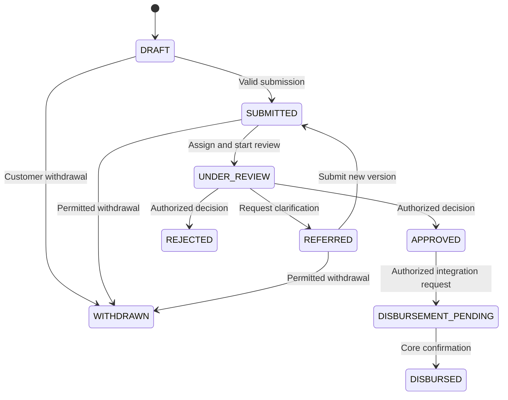
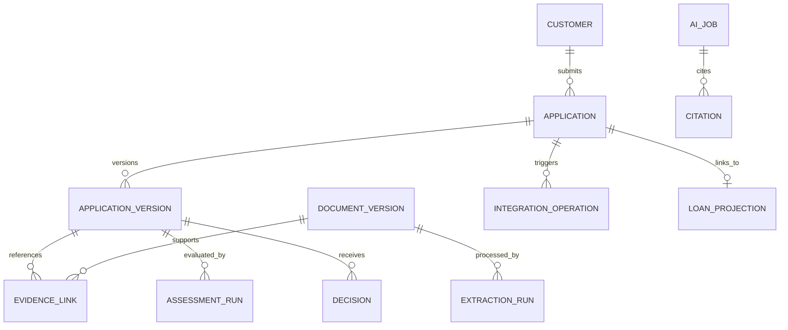
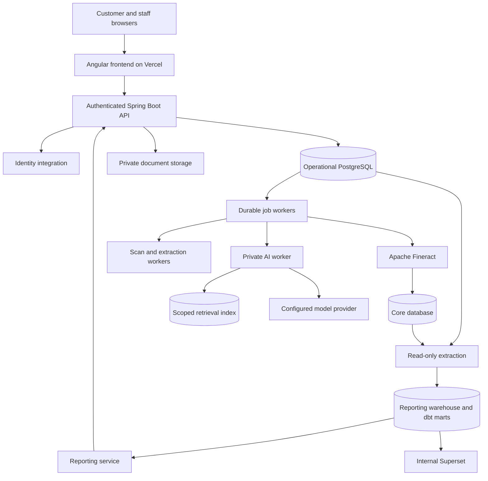

# Finandrome AI — Full-Scope Product and System Specification

**Product:** Finandrome AI
**Positioning:** An integrated lending operations and intelligence platform
**Repository:** https://github.com/KartikaySr/Finandrome_AI
**Intended frontend domain:** https://finandrome.kartikaysrivastava.in
**Specification date:** 23 October 2026
**Document type:** Target-state product, architecture and delivery specification

> This document defines what Finandrome is intended to become when its full scope is implemented. It is a development contract, not a claim that every capability already exists. The current foundation is an Angular frontend with synthetic browser-local workflows, four analytics perspectives and five scripted AI experiences. The Java lending and BI sources are present for integration. Production backend connectivity, live AI, durable storage and operational benchmarks remain implementation work. The domain above is the intended deployment address; this document does not verify its deployment status.

---

## Contents

1. Product vision and problem
2. Full-scope boundaries
3. Users, roles and authorization
4. End-to-end product journeys
5. Frontend information architecture
6. Backend modules and responsibilities
7. Application lifecycle and decision rules
8. Domain data model and ownership
9. API and event contracts
10. Fineract integration and reconciliation
11. Document processing and evidence
12. AI capabilities and evaluation
13. Analytics and metric definitions
14. Technology stack and deployment architecture
15. Security, privacy and operational controls
16. Reliability, observability and recovery
17. Testing and measurable acceptance targets
18. Repository structure and developer setup
19. Eleven-phase rollout
20. Definition of full-scope completion
21. Future extensions and open decisions

---

## 1. Product vision and problem

### 1.1 What Finandrome will be

Finandrome will connect the full loan application and operations journey in one product: customer intake, document collection, credit assessment, human decisions, core banking integration, repayment visibility, portfolio reporting and evidence-backed AI assistance.

A user should be able to move from a portfolio indicator to a loan, from that loan to the original application, and from the application to the evidence and decision history that explain it. This traceability is the central product principle.

### 1.2 The problem

Lending work is distributed across people, records and systems. A customer supplies information; an officer checks completeness; a reviewer assesses risk; a manager authorizes a decision; a core platform records the loan; an analyst measures portfolio performance. Fragmented tools make these handoffs difficult to inspect.

Finandrome addresses five specific problems:

- **Fragmented application context:** combine applicant data, product terms, documents, risk assessments and review history around one versioned application.
- **Unclear next steps:** make ownership, missing evidence, referral reasons and permitted actions visible.
- **Disconnected origination and servicing:** preserve a reliable link between approved applications and Fineract loan accounts.
- **Inconsistent reporting:** define financial metrics once, reconcile their inputs and expose freshness and scope.
- **AI answers without evidence:** provide assistance linked to authorized documents, application versions and metric results.

### 1.3 Intended value

Customers gain a clear intake flow and application status. Lending staff gain an organized work queue and complete case context. Managers gain explicit approval controls. Analysts gain consistent portfolio measures and drill-downs. Auditors gain reconstructable decision history.

Reduced turnaround time and improved extraction accuracy are outcomes to measure after integration. They are not assumed benefits or existing achievements.

### 1.4 Product identity

The interface will retain the current Web3-inspired visual direction: charcoal surfaces, restrained lime accents, geometric orbital visuals, precise typography and responsive layouts. “Web3-inspired” describes the design. Wallets, tokens, smart contracts and blockchain transactions are not required for the defined lending platform.

## 2. Full-scope boundaries

### 2.1 Included in the first complete platform release

- One deployable organization with multiple branches, with tenant identifiers and isolation boundaries designed for future expansion.
- Six primary roles and server-enforced permissions.
- Configurable lending products backed by Fineract product references.
- Customer profiles, application drafts, immutable submissions and resubmissions.
- Private document storage, scanning, evidence review and asynchronous extraction.
- Versioned deterministic scoring, human review and approval policies.
- Idempotent sandbox loan creation and disbursement through Fineract.
- Loan account, schedule, repayment and arrears visibility from the core system.
- Collection follow-up queues and case notes; accounting transactions remain core-owned.
- Four reconciled analytics perspectives, drill-downs and scoped exports.
- Five evidence-backed AI capabilities with reproducible evaluations.
- Notifications, durable audit events, reconciliation and operator recovery.
- A Vercel frontend and separately hosted API, workers, databases and analytics services.
- Automated tests, deployment controls, backups and an evidence package for demonstration.

### 2.2 Explicit boundaries

Finandrome will not implement its own banking ledger, independently calculate authoritative repayment balances, hold funds or replace the core system's accounting rules. A sandbox banking integration demonstrates the workflow; a live-money deployment requires additional operational and business arrangements beyond this specification.

The initial complete release will support INR as the reporting currency. Multi-currency reporting requires explicit exchange-rate sources, conversion dates and rounding policies and is a later extension.

External credit bureaus, identity providers for regulated verification, e-signatures and payment gateways are optional adapters. Their presence must not be implied by a UI placeholder.

## 3. Users, roles and authorization

### 3.1 Customer

Customers can manage their own profile, create and edit drafts, submit applications, supply requested evidence, review their status, read notifications and view their linked loans and schedules. They cannot see internal review notes, other customers' records or staff-only policy material.

### 3.2 Loan officer

Officers manage assigned or branch-scoped intake queues, assist with applications, request missing information, review document completeness and prepare cases for credit review. They cannot authorize a disbursement merely because they created the application.

### 3.3 Credit reviewer

Reviewers inspect submitted versions, examine verified evidence, run or inspect deterministic assessments, record recommendations and refer cases for clarification. Any decision override requires an explicit permitted action and rationale.

### 3.4 Branch manager

Managers approve or reject cases within configured limits and authorize disbursement requests. A maker-checker policy will prevent a person from approving their own submitted case where that policy applies. Higher-limit or exceptional cases follow configured escalation rules.

### 3.5 Auditor / analyst

This role provides read-only inspection of authorized cases, audit history, reconciliation and reports. Sensitive document downloads and bulk exports are separate permissions. The same base role may receive an analyst-oriented navigation layout without introducing a seventh primary role.

### 3.6 Administrator

Administrators manage users, branch membership, permission policies, product references and operational settings. Administration does not automatically confer credit approval authority. Access to customer documents and lending actions must be granted explicitly.

### 3.7 Authorization model

Every API operation evaluates the authenticated principal, tenant, branch, customer linkage, resource ownership, action permission and current workflow state. Tenant and customer ownership come from trusted server context, never from an unchecked request field.

Authorization applies equally to list queries, object endpoints, exports, background jobs, AI retrieval and signed document URLs. Frontend route guards improve navigation; server checks enforce access.

## 4. End-to-end product journeys

### 4.1 Customer application

1. Sign in and complete the customer profile.
2. Select an eligible product and read its current terms.
3. Complete applicant, financial, requested-loan and evidence sections.
4. Save a draft and resume it later on another device.
5. Upload documents into private quarantine storage.
6. Review declarations and consent records.
7. Submit an immutable application version.
8. Receive status changes and respond to a referral by submitting a new version.

**Completion condition:** a submitted application has a durable identifier, product/terms snapshot, ownership, required declarations, validated fields and a traceable evidence set.

### 4.2 Staff review and decision

1. Open a branch-scoped work queue.
2. Claim or receive an assignment without overwriting another reviewer's assignment.
3. Inspect the submitted version and document states.
4. Review extracted fields alongside source pages; correct uncertain values.
5. Run the configured deterministic scoring policy against a frozen input snapshot.
6. Read an optional AI brief with evidence references.
7. Refer, recommend, approve or reject within role and amount limits.
8. Store the decision, rationale, policy version and actor.

**Completion condition:** a third party with appropriate access can reconstruct the inputs, evidence, policy and human decision without relying on a current mutable screen.

### 4.3 Approval to loan account

1. Confirm that the approved version is still eligible for integration.
2. Create an idempotent integration operation and queue it durably.
3. Resolve or create the mapped Fineract customer.
4. Create the core loan using approved product and term mappings.
5. Authorize and request disbursement through the supported core flow.
6. Handle ambiguous outcomes by reconciliation before retrying.
7. Link the confirmed core account to the application.
8. Show confirmed account status and transaction references.

**Completion condition:** repeated requests or worker retries cannot silently create a duplicate customer, loan or disbursement. An uncertain result remains visibly pending until reconciled.

### 4.4 Servicing and collection follow-up

Staff and customers view core-owned schedules and repayment history according to their permissions. Staff can inspect overdue accounts, create follow-up tasks, record contact outcomes and track promised follow-up dates. A case note must not change a financial balance.

If repayment posting is enabled for the sandbox release, it is a separate authorized core command with idempotency, confirmation and reconciliation. Customer-facing payment collection remains an optional payment-provider integration.

### 4.5 Portfolio investigation

An analyst selects an as-of date, branch and product scope; inspects a KPI; opens its definition and freshness; drills into contributing loans; exports the authorized rows; and asks the portfolio assistant to explain the same approved aggregate result.

## 5. Frontend information architecture

### 5.1 Public experience

- Product landing page with the lending journey and interface previews.
- Product capabilities and architecture overview.
- Sign-in and a clearly separate synthetic demonstration entry point.
- Product documentation and license links.
- Accessible error, unavailable-service and unknown-route pages.

### 5.2 Authenticated workspace

**Overview:** role-specific KPIs, assigned work, pending actions, recent activity and service freshness.

**Applications:** search, branch/product/status filters, sorting, saved views, pagination, assignment and scoped export.

**Application intake:** a validated multi-step form, save/resume, eligibility hints, evidence checklist and submission review.

**Application detail:** applicant context, requested terms, submitted versions, evidence, scoring, AI brief, notes, decisions and timeline.

**Review and approvals:** separate queues for completeness review, credit assessment, referred cases, approval requests and exceptions. Actions show prerequisites and require reasons where policy demands them.

**Loans:** core account reference, authoritative balances, schedule, transaction history, arrears, synchronization time and linked application.

**Documents:** upload progress, scan/extraction states, source preview, review decisions, version history and controlled download.

**Analytics:** portfolio health, delinquency, repayments and origination with definitions, as-of dates, filters and drill-downs.

**Intelligence:** five task-oriented assistants, evidence viewer, job state, feedback, limitations and approved output export.

**Operations:** reconciliation exceptions, integration attempts, failed jobs and permission-controlled retry actions.

**Administration:** users, branches, roles, lending product references, policy versions, notification settings and audit access.

**Profile and settings:** preferences, sessions, accessibility options and notification subscriptions.

### 5.3 Interaction requirements

All data screens need loading, empty, partial, stale, failed and forbidden states. A failed request must not look like an empty portfolio. Forms preserve recoverable edits and show server validation next to the relevant fields. Destructive or financial actions require explicit confirmation and display the result of the server operation.

Pagination and filters must be server-backed at full scope. Large tables use stable ordering and bounded responses. Accessible labels, keyboard navigation, focus restoration, contrast and reduced motion are acceptance requirements.

### 5.4 Frontend architecture

Keep Angular standalone routes and feature boundaries. Introduce typed feature clients and a repository/adapter boundary so the current demo store can coexist with an API-backed implementation. Demo mode must be visibly labeled and must never fall back silently when production requests fail.

The browser stores display preferences and minimal transient state. Customer documents, credentials and authoritative lending records belong on the server. Generated API types and contract tests prevent frontend/backend drift.

## 6. Backend modules and responsibilities

The initial backend should be a **modular Spring Boot application**, with private Python workers for AI and a separate analytics workload. Separate modules by domain ownership before introducing independently deployed microservices.

### 6.1 Identity and access

Own authenticated sessions, user-to-customer linkage, organization and branch membership, action permissions, session revocation and access-policy evaluation. Use an OIDC-compatible identity integration or a reviewed server-side authentication implementation. Select the provider before the authenticated release.

### 6.2 Customers

Own customer profiles, verified contact attributes, consent references and core customer mappings. Maintain change history for fields used in assessments. Resolve duplicate candidates through an explicit review process rather than automatically merging ambiguous people.

### 6.3 Product catalog

Own user-facing product descriptions, application requirements, allowed term ranges and references to Fineract products. Capture the approved product configuration/version on submission. Validate core compatibility before enabling a product.

### 6.4 Origination

Own drafts, application versions, declarations, submission rules, completeness checks and state transitions. Submitted versions are immutable; corrections create a new version or a separately tracked correction record according to policy.

### 6.5 Documents

Own object metadata, upload sessions, scan results, extraction references, evidence links, human verification and retention status. Raw bytes reside in private object storage.

### 6.6 Assessment

Own versioned deterministic scoring rules, input snapshots, calculated factors, reason codes and assessment outputs. The module must support replay of an old assessment using its original rule version. It must not substitute a language-model response for a credit policy.

### 6.7 Review and decisions

Own assignments, review notes, recommendations, referrals, approval limits, maker-checker rules, final decisions and escalation. Store optimistic-concurrency versions to prevent two reviewers from silently overwriting each other.

### 6.8 Core banking integration

Own mappings, external commands, idempotency, core response references, reconciliation and recovery. This is the only module authorized to issue banking commands to Fineract.

### 6.9 Loan servicing projection

Own a query-friendly local projection of core account data and its synchronization metadata. It is a cache/read model, not an independent ledger. Expose core-confirmed timestamps and stale-data indicators.

### 6.10 Collection follow-up

Own staff assignments, contact notes, follow-up dates and case status. Use core arrears data to build queues. Never infer a successful payment from a staff note or a promise-to-pay record.

### 6.11 Notifications

Own event-driven in-app messages, optional email delivery, templates, preferences and delivery attempts. Use deduplication keys so retried events do not send duplicate notifications. Keep sensitive details out of email subjects and previews.

### 6.12 Reporting gateway

Own authorized report definitions, approved query parameters, export requests and access to warehouse results. Exports are generated asynchronously when large and expire after a defined retention period.

### 6.13 AI gateway

Own task authorization, evidence scope, provider configuration, prompt/schema versions, budgets, job submission and response validation. Workers cannot issue approval or disbursement commands.

### 6.14 Audit and operations

Own durable business audit records, integration/job inspection, controlled retries and operational dashboards. Business audit and diagnostic logs are separate: logs explain execution; audit records explain consequential actions.

## 7. Application lifecycle and decision rules

### 7.1 Target state machine



The final implementation may refine names, but must preserve the distinction between a decision, an integration request and core confirmation. A transport timeout does not return an application to an approvable state or prove that disbursement failed.

### 7.2 Transition invariants

- A submitted version cannot be edited in place.
- Approval binds to a specific application version and assessment.
- A changed evidence set invalidates dependent conclusions according to policy.
- Required document and review gates must pass before approval.
- The actor must satisfy role, branch, amount-limit and maker-checker requirements.
- Rejection and referral require structured reasons plus useful human context.
- Disbursement requires an approved case and an eligible core state.
- Integration exceptions are tracked independently from business rejection.
- An existing completed operation is returned for a repeated identical command.
- Concurrent commands use row/version checks; stale writes return a conflict.

## 8. Domain data model and ownership

### 8.1 Core entities

**Tenant, Branch, User, Role, Permission, Membership:** identity and organizational scope.

**Customer, CustomerContact, ConsentRecord, CoreCustomerMapping:** applicant identity, declarations and core linkage.

**LoanProduct, ProductVersion:** application requirements and core product mapping.

**Application:** stable business identity, customer, branch, current state and current version pointer.

**ApplicationVersion:** immutable submitted fields, product snapshot, declaration references and submission time.

**Document, DocumentVersion, EvidenceLink:** stable document identity, immutable object version and attachment to a specific application version.

**ScanResult, ExtractionRun, ExtractedField, VerificationDecision:** machine processing results and human review with source coordinates.

**AssessmentPolicyVersion, AssessmentRun, AssessmentFactor:** deterministic policy, frozen inputs and explainable outputs.

**ReviewAssignment, ReviewNote, Referral, Decision:** human workflow and authorization evidence.

**IntegrationOperation, IntegrationAttempt, ReconciliationCase:** external command state, attempts and unresolved outcomes.

**LoanProjection, ScheduleProjection, TransactionProjection:** synchronized core-owned account data.

**CollectionCase, FollowUpTask:** nonfinancial servicing work.

**AIJob, AIArtifact, Citation, AIFeedback, EvaluationRun:** governed assistance and evaluation artifacts.

**AuditEvent, OutboxEvent, Notification, ExportJob:** cross-cutting durable records.

### 8.2 Relationship model



### 8.3 Data conventions

Use stable identifiers and separately formatted display references. Store timestamps in UTC and define the organization's reporting timezone explicitly. Store money with fixed precision and an ISO currency code; never use binary floating point for authoritative financial amounts.

Mutable entities use a version column. Financial commands use idempotency keys. Major records carry tenant and branch/customer ownership where applicable. Sensitive values are excluded from ordinary application logs.

Operational data, raw documents, analytics models and AI embeddings have distinct owners and retention rules. Embeddings are derived sensitive data and inherit the source document's access and deletion requirements.

## 9. API and event contracts

### 9.1 API conventions

Use a versioned REST contract under `/api/v1`. The endpoint names below are proposed contracts, not a claim that the current service exposes them.

- `GET /me` — principal, permissions and scoped profile.
- `GET /products` — enabled application products.
- `GET/POST /applications` — scoped list and draft creation.
- `GET/PATCH /applications/{id}` — detail and permitted draft changes.
- `POST /applications/{id}/submissions` — validate and freeze a submission.
- `POST /applications/{id}/referrals` — request clarification.
- `POST /applications/{id}/assessments` — create an assessment run.
- `POST /applications/{id}/decisions` — authorize a decision.
- `POST /applications/{id}/disbursement-requests` — create an asynchronous core operation.
- `POST /documents/upload-sessions` — authorize bounded private upload.
- `POST /documents/{id}/upload-completion` — verify object metadata and queue scanning.
- `GET /documents/{id}/access` — short-lived authorized view/download access.
- `GET /loans/{id}/schedule` and `/transactions` — synchronized core detail.
- `GET /reports/{reportKey}` — approved metrics with scope/freshness metadata.
- `POST /exports` — authorized asynchronous export.
- `POST /ai/jobs` and `GET /ai/jobs/{id}` — bounded task execution.
- `GET /operations/{id}` — integration progress.
- `GET /audit-events` — scoped business history.

### 9.2 Request and response behavior

List endpoints have bounded page sizes, validated filters and deterministic ordering. Responses include a correlation identifier. Validation errors identify fields; authorization errors reveal no unauthorized record content. State conflicts return a recoverable conflict response.

Financial commands require an `Idempotency-Key`. Persist the key with principal/tenant scope, operation kind and request hash. Reusing the key with a different request is a conflict, not a new operation. Use entity version checks for concurrent edits.

Long-running tasks return an operation/job identifier and status location. The UI polls initially; server-sent updates can be added later without changing durable job semantics.

### 9.3 Durable events

Business transactions write outbox events atomically with their state changes. Workers publish/process these at least once; consumers deduplicate by event identifier and operation key. Do not claim distributed exactly-once delivery.

Representative events:

- `ApplicationSubmitted`
- `ApplicationReferred`
- `DocumentScanCompleted`
- `DocumentExtractionCompleted`
- `AssessmentCompleted`
- `DecisionRecorded`
- `DisbursementRequested`
- `CoreOperationConfirmed`
- `LoanProjectionRefreshed`
- `AIJobCompleted`

Events carry identifiers, schema version, tenant scope, time and correlation metadata. Prefer references over raw personal documents or unrestricted prompt text.

## 10. Fineract integration and reconciliation

### 10.1 System of record

Fineract owns loan accounts, repayment schedules, balances, transactions and accounting outcomes. Finandrome owns application intake, review context and orchestration. Local projections include the core identifier and last successful synchronization time.

### 10.2 Integration operation states

An operation progresses through `QUEUED`, `RUNNING`, `SUCCEEDED`, `RETRYABLE_FAILURE`, `PERMANENT_FAILURE` or `RECONCILIATION_REQUIRED`. A timeout after submission is ambiguous and enters reconciliation when the external effect cannot be safely established.

### 10.3 Recovery rules

Before retrying an ambiguous create/disbursement action, inspect the mapped core resource and recorded references. Use supported external identifiers where available, backed by local uniqueness constraints and durable mappings. If uniqueness cannot be proved, require operator resolution rather than blind resubmission.

Retries use bounded backoff and an attempt limit. A failed worker can be restarted without losing the operation. A reconciliation screen shows request intent, attempts, core references and the permitted recovery action.

### 10.4 Data synchronization

Use incremental extraction or polling appropriate to the supported core interface. Preserve watermarks and replay windows. Represent reversals, corrections and late-arriving transactions explicitly. Reconcile counts and financial totals before publishing analytics snapshots.

## 11. Document processing and evidence

### 11.1 Pipeline

```text
Authorized upload session
  → private quarantine object
  → size/type/content validation
  → malware scan
  → accepted immutable document version
  → text extraction or OCR
  → structured field validation
  → reviewer verification
  → application evidence snapshot
```

Only accepted documents become eligible for extraction and ordinary viewing. User-provided filenames are display metadata, not storage paths. Signed URLs are short-lived and issued only after authorization. Upload completion verifies the actual object rather than trusting a browser declaration.

### 11.2 Extraction output

Every extracted value records field name, raw and normalized value, source page, source span or bounding box, extractor version and review state. A confidence value is a triage signal, not proof of correctness. Low-confidence, conflicting or missing required fields enter human review.

### 11.3 Evidence lifecycle

A replacement upload creates a new immutable version. Previous decisions continue to reference their original evidence snapshot. Document deletion and retention requests account for application, audit and policy obligations defined for the deployment. Deletion propagates to derived text, embeddings and cached AI artifacts where permitted.

## 12. AI capabilities and evaluation

AI assistance remains subordinate to evidence, permissions and human decisions. A completed platform must make it possible to inspect why an answer was produced and which source version it used.

### 12.1 Application brief

**Inputs:** authorized application version, verified evidence fields, deterministic assessment and permitted review history.

**Output:** concise case summary, declared income/obligations, missing information, discrepancies and reviewer questions, with citations.

**Acceptance:** all material factual statements resolve to authorized evidence; uncertain or missing information is identified. The model cannot invent income, debt or approval recommendations unsupported by policy.

### 12.2 Document intelligence

**Inputs:** accepted document versions and configured extraction schemas.

**Output:** structured fields, normalized values, source locations and discrepancy candidates.

**Acceptance:** extraction is evaluated against a held-out labeled corpus. Human corrections are stored separately from raw machine output. Identity or fraud conclusions are not inferred merely from unusual OCR text.

### 12.3 Policy copilot

**Inputs:** versioned, approved policy documents filtered by organization, role, product and effective date.

**Output:** cited answers describing relevant policy sections and any missing context.

**Acceptance:** retrieval permissions are applied before content reaches the model. Superseded policies are identified. Questions without sufficient support receive an abstention or request for clarification.

### 12.4 Score explanation

**Inputs:** immutable assessment results, actual factor contributions/reason codes and matching policy version.

**Output:** plain-language explanation of the existing calculation and review considerations.

**Acceptance:** the model does not invent factor contributions, recompute the authoritative score or change its decision category. When the policy provides no factor attribution, the interface says so.

### 12.5 Portfolio assistant

**Inputs:** approved semantic metric definitions and an authorized aggregate-query tool.

**Output:** scoped answers containing values, units, as-of time, filters, definition and optional chart specification.

**Acceptance:** a model cannot execute arbitrary SQL against operational databases. It selects from allowlisted tools/parameters; the server applies scope and computes the result. Currency arithmetic comes from the reporting service, not generated prose.

### 12.6 Shared AI execution path

1. Authorize the user and task.
2. Freeze permitted evidence identifiers and versions.
3. Enforce document readiness, limits and budget.
4. Retrieve only authorized evidence.
5. Execute a versioned prompt with structured output requirements.
6. Validate schema, citations, identifiers and permitted content.
7. Store the output, source manifest, model configuration, cost and latency.
8. Present the result with evidence and feedback controls.

Treat uploaded text as untrusted data. Instructions inside documents cannot modify system policy, invoke privileged tools or broaden retrieval. Provider failures are visible job failures; they do not silently produce fabricated answers.

### 12.7 Evaluation design

Create separate versioned development and held-out test datasets. Include clean, scanned, rotated, incomplete and conflicting documents; answerable and unanswerable policy questions; role-isolation cases; and adversarial instructions embedded in evidence.

Measure normalized field accuracy, factual support, citation correctness, abstention, unauthorized disclosure, task success, latency and cost. Record denominators and error categories. Re-run evaluations when the model, prompt, retriever, extraction tool or policy corpus changes.

## 13. Analytics and metric definitions

### 13.1 Data pipeline

Extract core and origination data into a restricted raw layer, transform through staging and intermediate models, and publish reconciled reporting marts using dbt. Superset may provide internal exploration; the Angular experience consumes authorized reporting APIs rather than exposing warehouse credentials.

Use a separate warehouse database or appropriately isolated analytical store so reporting cannot exhaust transaction capacity. Every published snapshot records source watermarks, transformation version and freshness.

### 13.2 Portfolio health

Show active account count, outstanding principal, disbursed principal by period and product/branch composition. Outstanding principal is a core-owned balance as of a defined date. It is not the original requested amount or the sum of future installments.

### 13.3 Delinquency and portfolio at risk

Define DPD from the core-supported delinquency interpretation and document whether thresholds use `>` or `>=`. For this target contract, **PAR30 means DPD > 30**, PAR60 means DPD > 60 and PAR90 means DPD > 90.

```text
PAR30 = outstanding principal of eligible loans with DPD > 30
        / outstanding principal of all eligible active loans
```

Use the entire outstanding principal of qualifying loans, not only overdue installments. Publish zero-denominator behavior explicitly as “not applicable.” Buckets must be non-overlapping, for example current, 1–30, 31–60, 61–90 and 91+ days.

### 13.4 Repayment behavior

Separate principal collected, interest collected, charges and total cash receipts. Define period boundaries and reversal handling. A collection-efficiency percentage must specify which receipts are allocated against which scheduled dues; do not label all cash received divided by all historical dues as efficiency.

### 13.5 Origination

Report submissions, referrals, decisions, disbursements, processing durations and product/branch funnels. Distinguish application cohorts from period event counts. Define approval rate as approved decisions divided by approved plus rejected final decisions within the selected decision period; show pending/referred cases separately.

Use immutable transition timestamps for turnaround calculations. Identify whether paused customer-response time is included. Show median and percentile durations, not only an average.

### 13.6 Reporting contracts

Each KPI has an identifier, business definition, formula, grain, source model, eligibility rules, currency, timezone, as-of semantics, owner and freshness threshold. Exports retain these definitions and the chosen filters. Customer views cannot inherit staff-wide aggregates through an unrestricted endpoint.

## 14. Technology stack and deployment architecture

### 14.1 Selected and proposed components

**Frontend:** Angular, TypeScript, signals, reactive forms, RxJS, SCSS and native SVG components. The repository currently pins Angular 22.2.3; future upgrades require compatibility checks rather than assuming that a particular version remains current.

**API:** Java 21 target, Spring Boot, Spring Security, Spring Data JPA, validation, Flyway and generated OpenAPI contracts. Reconcile inherited dependency versions and migration issues before integration.

**Operational storage:** PostgreSQL for origination, policies, audit, jobs and mappings. Fineract retains its supported core database configuration separately.

**Documents:** private S3-compatible object storage, quarantine lifecycle, a malware scanner and an asynchronous parsing/OCR adapter. Select the OCR engine by corpus evaluation.

**AI worker:** Python, FastAPI for private worker interfaces where needed, Pydantic schemas, provider adapters and PostgreSQL/pgvector for permission-scoped retrieval. No provider credentials enter the frontend bundle.

**Job processing:** a transactional outbox and PostgreSQL-backed durable job queue initially. Add a broker only if measured throughput or topology requires it.

**Analytics:** Python extraction, PostgreSQL warehouse, dbt-postgres and Superset for internal analysis.

**Verification:** Vitest, Playwright, Java unit/integration tests, database/container tests, Python tests, dbt checks, API contract tests, load tests and AI evaluations.

**Operations:** containerized backend services, structured logs, OpenTelemetry-compatible instrumentation, dashboards, error tracking and backup automation. Exact hosting and telemetry vendors remain deployment decisions.

### 14.2 Deployment topology



The diagram shows logical responsibilities; it does not require one server per box. Network boundaries keep databases, object administration, internal BI and workers private. Vercel hosts the static frontend; persistent Java/Python processes run on separate infrastructure.

### 14.3 Environments

- **Local:** synthetic seeds, isolated containers and test provider adapters.
- **CI:** ephemeral databases, stubbed external failures and reproducible evaluation fixtures.
- **Staging:** integrated Fineract sandbox and synthetic documents with production-like topology.
- **Portfolio demo:** controlled synthetic dataset, restricted actions and explicit demo labeling.
- **Production-ready deployment profile:** durable hosting, monitored backups, secret management and approved operational policies; enabled only when its release gates are satisfied.

## 15. Security, privacy and operational controls

### 15.1 Sessions and request protection

Use secure, HttpOnly session cookies where the chosen auth topology supports them, with appropriate SameSite and CSRF protection. Restrict allowed frontend origins. Expire and revoke sessions, rate-limit sensitive operations and enforce stronger authentication for privileged staff where supported.

### 15.2 Data access

Enforce scope in service and query boundaries, with integration tests for direct object access, nested resources, exports and AI retrieval. Use least-privilege database and storage credentials. Avoid publicly accessible buckets and unauthenticated dashboards.

### 15.3 Audit

Record actor, effective permissions/context, action, resource/version, timestamp, correlation ID and relevant change references. Restrict modification rights and support durable archival. An append-only application table alone is not a guarantee against privileged database tampering.

### 15.4 Privacy

Define retention schedules by data class before real customer intake. Minimize collection, redact diagnostic logs and exclude sensitive content from analytics when unnecessary. Record document access and provider data transfer where appropriate. Keep synthetic fixtures distinguishable from real records.

### 15.5 Configuration

Keep secrets in server-side environment/secret stores. Validate required configuration on startup. Rotate external credentials and document recovery procedures. Lock dependencies, scan changes and preserve applicable license notices in the repository.

## 16. Reliability, observability and recovery

### 16.1 What to measure

Track API request rate/error rate/latency, database saturation, job age, retry counts, reconciliation backlog, core synchronization lag, warehouse freshness, document processing time, AI latency/cost and notification delivery outcomes.

Correlate a customer request through its business transaction, outbox event, worker attempt and external command. Do not place raw documents or unrestricted model prompts in traces.

### 16.2 Failure behavior

- Core unavailable: preserve the request and show pending/retry state.
- Ambiguous core result: reconcile before issuing a new external command.
- AI unavailable: retain normal human review; show an explicit assistance failure.
- OCR uncertain: route to manual verification.
- Warehouse stale: display freshness and withhold misleading current labels.
- Notification failure: retry delivery without rolling back the recorded business action.
- Browser refresh: retrieve server-owned state and resume eligible drafts.

### 16.3 Recovery

Back up operational and core databases with a compatible recovery strategy, version documents and test restoration. Keep database migrations backward-compatible during rolling deployments where possible. Rehearse worker restart, failed deployment rollback and reconciliation recovery with documented results.

## 17. Testing and measurable acceptance targets

These are **proposed release gates**, not achieved metrics. Final performance targets depend on the declared infrastructure and benchmark dataset. Record raw evidence and environment details alongside every result.

### 17.1 Functional completion

- Six primary roles exercised through allowed and denied actions.
- Four analytics perspectives with reconciled definitions and drill-downs.
- Five AI tasks with evidence and evaluation records.
- At least one real sandbox journey from submission through core-confirmed disbursement and servicing visibility.
- Every application transition covered by permitted, forbidden and invalid-state tests.
- No duplicate external financial effect in the defined retry, timeout and worker-crash test suite.

### 17.2 Performance benchmark proposal

Use a documented synthetic baseline of 10,000 applications, 5,000 loans and representative document metadata. Run a 15-minute workload with 50 concurrent sessions after warm-up, declaring request mix and hardware.

- Normal indexed API reads: p95 at or below 500 ms, excluding external provider latency.
- Local transactional writes: p95 at or below 1 second, excluding asynchronous core/AI completion.
- Precomputed dashboard responses: p95 at or below 1 second.
- Server errors: below 1% for valid steady-state requests under the declared workload; injected failures reported separately.
- Frontend: target LCP at or below 2.5 seconds and CLS at or below 0.1 under a recorded lab profile; field results reported separately if sufficient real traffic exists.

### 17.3 Data quality gates

- All critical dbt uniqueness, relationship and required-field checks pass.
- Financial reconciliation has no unexplained mismatch at the defined currency precision.
- All dashboard metrics disclose snapshot freshness and scope.
- Synthetic fixture and warehouse formula tests cover zero balances, reversals, overdue boundaries and late-arriving events.

### 17.4 AI evaluation proposal

Use at least 200 held-out documents for extraction and 150 held-out questions across policy, application and portfolio tasks, with dataset composition recorded.

- Target at least 95% normalized accuracy on the explicitly enumerated required extraction fields; publish per-field and document-type results.
- Target at least 95% factual support for material claims in evaluated answers, with citation correctness reviewed separately.
- Target at least 95% correct abstention on a separately labeled unanswerable subset.
- Zero unauthorized evidence disclosures in the defined role-isolation and adversarial test suite; this is a test result, not a proof of universal safety.
- Record p50/p95 task latency, tokens and cost per successful task. Choose cost/latency budgets after provider benchmarking.

### 17.5 Accessibility and operations

No known critical accessibility blocker in the core intake/review journey after automated and manual keyboard checks. Test at mobile and desktop widths, including zoom and reduced motion.

Proposed staging recovery targets are RPO no greater than 24 hours and RTO no greater than 4 hours, proven by a restore exercise. Tighten these before any deployment whose business requirements need lower data loss or downtime.

### 17.6 Business-impact evidence

Measure review turnaround and human correction effort with a defined baseline and comparable cases. A claim such as “reduced review time by X%” requires measured before/after times, sample sizes and disclosure of whether the test was simulated. Do not derive business improvement percentages from the existence of features.

## 18. Repository structure and developer setup

### 18.1 Target layout

```text
Finandrome_AI/
  apps/
    web/                         Angular application and browser tests
  services/
    lending-api/                 Modular Java backend
    ai-worker/                   Python task execution and provider adapters
    document-worker/             Scan/extraction integration, if separate
  analytics/
    ingestion/                   Incremental extraction and reconciliation
    dbt/                         Staging, intermediate and reporting models
    dashboards/                  Internal BI configuration
  packages/
    contracts/                   Generated API/event schemas and fixtures
  infra/
    compose/                     Local dependencies and sandbox topology
    deploy/                      Hosting configuration and runbooks
    observability/               Dashboard and alert definitions
  tests/
    integration/                 Cross-service and core sandbox checks
    load/                        Versioned benchmark scenarios
    evaluations/                 AI datasets, rubrics and result manifests
  docs/
    architecture/                Target scope, decisions and diagrams
    api/                         Published contracts
    runbooks/                    Deploy, restore, reconcile and rotate
    evidence/                    Verified results and limitations
    media/                       Product screenshots
  .github/workflows/             Build, test and release checks
```

This is the target structure. Only directories already present in the repository should be treated as existing implementation.

### 18.2 Current frontend setup

```bash
git clone https://github.com/KartikaySr/Finandrome_AI.git
cd Finandrome_AI/apps/web
npm ci
npm start
```

Use a Node version satisfying the repository's `engines` field. The current demo frontend does not need a backend or model API key.

### 18.3 Target integrated setup contract

The full release must supply a documented bootstrap command or script that validates configuration, starts dependencies, applies compatible migrations, initializes the Fineract sandbox, seeds synthetic data and prints service URLs. Do not publish unimplemented commands as working setup instructions.

Provide `.env.example` files with placeholders for database URLs, auth issuer/client settings, core endpoint and credentials, object storage, model provider, mail transport and allowed origins. Provide health/readiness checks, teardown instructions and a safe reset procedure for synthetic environments.

### 18.4 CI and delivery

Frontend CI runs type checks, linting, formatting, unit tests, production build and browser journeys. Backend CI adds migration and database tests, permission tests and core adapter contracts. AI CI validates schemas and deterministic fixtures; controlled evaluation runs track provider-dependent regressions.

Deploy frontend previews separately from backend staging. Do not give untrusted preview branches access to production secrets or private datasets. Promote releases using immutable build references and an explicit migration/rollback plan.

## 19. Eleven-phase rollout

The frontend has deliberately been built first. Phase numbers below describe dependencies and acceptance gates, not a claim that earlier phases are complete merely because screens exist.

### Phase 1 — Product contracts and baseline

**Deliver:** agreed scope, roles, lifecycle, data ownership, KPI glossary, architecture decisions and synthetic fixture design.

**Gate:** every full-scope feature maps to an owner, API/data contract and acceptance criterion; inherited source blockers are cataloged.

### Phase 2 — Reproducible platform foundation

**Deliver:** backend dependency alignment, resolved migration conflicts, working containers, validated configuration and repeatable local bootstrap.

**Gate:** a clean environment starts reliably and passes migration/health checks without manual database edits.

### Phase 3 — Frontend completion and real identity

**Deliver:** polished existing views, typed API adapter boundary, authenticated sessions, server permissions, branch scope and account linkage.

**Gate:** six-role allowed/denied tests pass; real-mode failures never silently switch to demo data.

### Phase 4 — Persistent intake and evidence

**Deliver:** cross-device drafts, immutable submissions, private uploads, scan states, evidence versions and customer referrals.

**Gate:** a submitted application survives restart, preserves its evidence snapshot and rejects unauthorized reads/changes.

### Phase 5 — Assessment and controlled decisions

**Deliver:** versioned deterministic scoring, review assignments, reasons, approval limits, maker-checker rules and audit events.

**Gate:** an assessment can be replayed and a decision reconstructed; concurrent or unauthorized actions are rejected.

### Phase 6 — Fineract lifecycle and servicing

**Deliver:** customer/product mappings, idempotent loan/disbursement orchestration, reconciliation, authoritative loan detail and follow-up queues.

**Gate:** a sandbox journey completes; timeout/retry/crash scenarios produce no duplicate financial effect in the tested cases.

### Phase 7 — Warehouse and four analytics views

**Deliver:** incremental extraction, dbt models, KPI definitions, reconciliation, dashboard APIs and scoped exports.

**Gate:** critical quality tests pass and financial totals reconcile with the core snapshot.

### Phase 8 — AI and document foundations

**Deliver:** worker execution, OCR/parsing adapters, evidence index, versioned prompts/schemas, permission-aware retrieval and evaluation datasets.

**Gate:** document provenance and role isolation work before enabling live assistance in review workflows.

### Phase 9 — Five live AI capabilities

**Deliver:** application brief, document intelligence, policy copilot, score explanation and portfolio assistant with feedback and evidence viewers.

**Gate:** held-out evaluation results satisfy agreed thresholds or clearly block release; models cannot perform lending decisions.

### Phase 10 — Integrated quality and recovery

**Deliver:** end-to-end tests, load results, accessibility review, dependency/security remediation, failure drills, backup restoration and operational dashboards.

**Gate:** release-critical defects are resolved and performance/recovery targets are supported by recorded tests.

### Phase 11 — Deployment and portfolio release

**Deliver:** Vercel frontend, hosted services, configured domain/HTTPS, controlled synthetic demo, runbooks, screenshots, architecture documentation and measured project evidence.

**Gate:** direct links, authentication, the complete sandbox journey, reporting and AI operate in the deployed environment; claims in the README and resume match recorded evidence.

## 20. Definition of full-scope completion

Finandrome is complete against this specification when:

- Customers and staff use persistent authenticated workflows across devices.
- Server-side permissions protect every record, export and AI evidence path.
- Applications, documents, assessments and decisions retain versioned provenance.
- A real Fineract sandbox journey links an application to a confirmed loan account.
- Servicing screens reflect authoritative core balances and schedules with freshness.
- External failures are recoverable without blind duplicate financial commands.
- Four analytics perspectives reconcile to documented data sources.
- Five live AI tasks produce validated, evidence-linked outputs and have evaluation results.
- Notifications, audit, job recovery and reconciliation are operational.
- The frontend, API and workers are deployed with monitoring and tested backups.
- A new developer can follow setup instructions and reproduce the synthetic demonstration.
- Release documentation distinguishes measured achievements, remaining limitations and optional extensions.

The strongest final demonstration is a single traceable case: **customer submission → verified evidence → reproducible assessment → authorized decision → confirmed core loan → portfolio reporting → evidence-backed explanation**.

## 21. Future extensions and open decisions

### 21.1 Extensions beyond the defined complete release

- Live payment collection and reconciliation with a payment provider.
- External bureau and identity verification adapters.
- E-signature and legally reviewed agreement generation.
- Multi-currency portfolios and controlled exchange-rate reporting.
- Multi-organization self-service provisioning and commercial billing.
- Advanced collection optimization and predictive models evaluated independently of deterministic credit policy.
- Offline field-officer workflows and native mobile applications.
- Blockchain functionality only if a concrete business requirement justifies it.

### 21.2 Decisions required during implementation

Choose the identity provider, persistent hosting, object storage, OCR engine and model provider through implementation constraints and evaluation. Finalize product eligibility rules, approval thresholds, retention periods and deployment-specific recovery requirements with explicit owners.

These choices should be captured as architecture decision records. They do not prevent building the domain boundaries now; they prevent treating an untested vendor or policy assumption as a completed feature.

---

**Project summary:** Finandrome AI is intended to become an integrated lending operations platform combining a premium Angular experience, controlled loan origination, Fineract-backed servicing, reconciled analytics and evidence-backed AI assistance. Its distinguishing quality will be the continuity between the application, evidence, human decision, core account and portfolio explanation.
